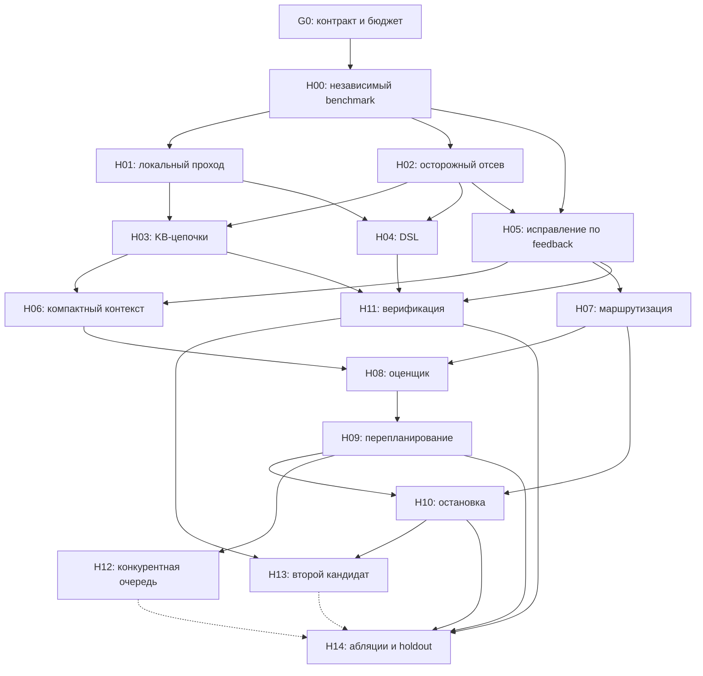
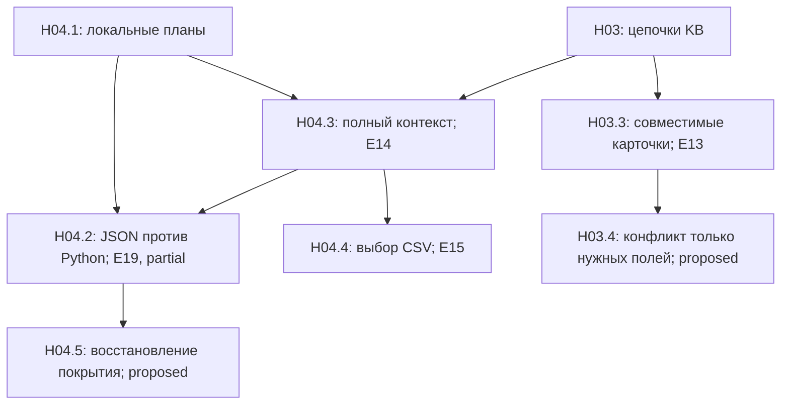
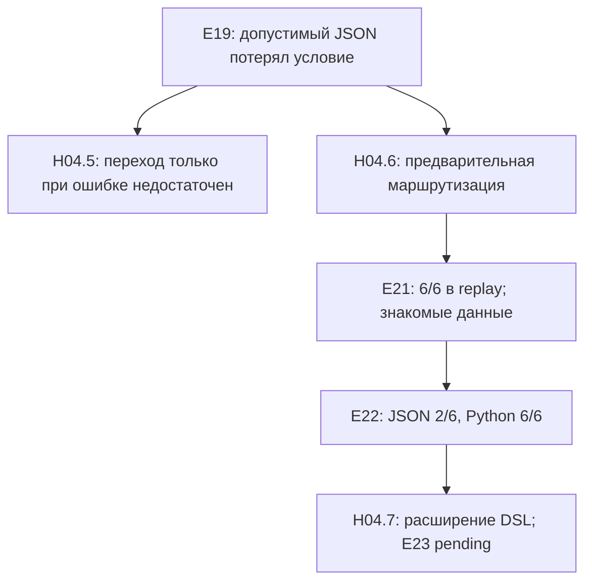
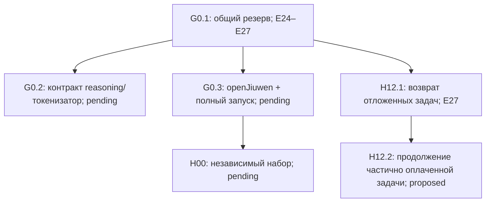
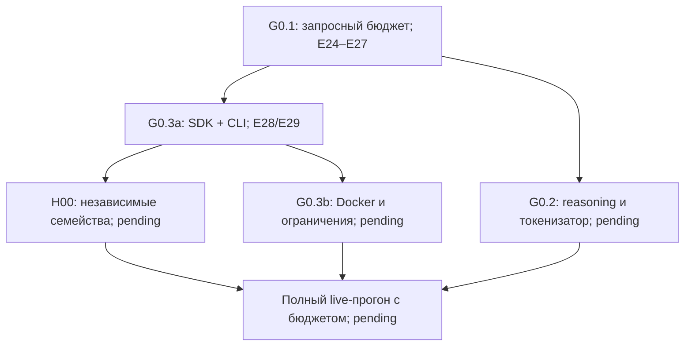

# Реестр гипотез и граф экспериментов

Дата: 10 ноября 2026. Исходный план составлен по материалам и статическому просмотру кода. Замеры и текущие статусы приведены в разделах 10–18 и имеют приоритет над исходными PROPOSED в таблице. Последняя сводка — раздел 18: JSON v2 решил 6/6, но дороже прежней комбинации маршрутов; проверка переключена на общий бюджет. E24–E27 выявили и исправили гонку резервирования, потерю известного расхода и отказ от бесплатных задач при нулевом бюджете. G0 в целом остаётся PARTIAL.

## 1. Основания и поправки к ресерчу

Просмотрены локальный регламент, текст памятки участника, README.md, team_workplan.md, восемь task.json, модули harness, run_agent.py, генератор, обучающий скрипт и summary_stats.json. Дополнительно прочитан присланный ресерч «Вставленный текст.txt». Перечисление файлов не означает полного содержательного аудита каждой строки CSV и каждой карточки KB.

Авторитет для постановки — регламент и реальные входы. Ресерч содержит существенные ошибки: восемь примеров приняты за финальный набор; ограничения названы отсутствующими; предложены внешние модели, GPU и внешние вычислительные API. В действительности оптимизируем сумму reward на 100 задачах при общем токенном бюджете и часовом дедлайне. При равных баллах выигрывает меньший расход токенов. Локальные нейросетевые модели запрещены. Доступны четыре Qwen через прокси; openJiuwen обязателен. Примеры data_analysis — вычисления по CSV, а не обучение моделей с AUC/F1.

В регламенте есть внутреннее расхождение CPU: таблица указывает 4 ядра, пример запуска — 8. Проверять производительность при 4 ядрах; не строить решение, которому обязательно нужны 8. Конкурентность агента — не более 5; более высокий лимит API не заменяет это ограничение. Число 100000 и имя BUDGET указаны в проектной документации; фактический лимит должен поступать через согласованный интерфейс запуска, а не предполагаться бесконечным.

Из ресерча переносим методы, но не заявления о гарантированном превосходстве:

| Источник | Перенос в проект | Что требуется проверить |
|---|---|---|
| TaskWeaver, https://arxiv.org/abs/2311.17541 | Перевод запроса в исполняемую программу, локальное вычисление | Лучше ли компактная программа/DSL прямого ответа по баллам и токенам |
| AutoKaggle, https://arxiv.org/abs/2410.20424 | Цикл исполнение → диагностика → исправление → тесты | Окупается ли ещё одна итерация на наших коротких задачах |
| RE-RAG, https://arxiv.org/abs/2406.05794 | Отбор релевантных данных и оценка достаточности контекста | Достаточен ли структурный поиск по KB без нейросетевого retriever |
| How Do AI Agents Spend Your Money?, https://arxiv.org/abs/2604.22750 (из README) | Измерение фактического расхода, проверка оценок на траекториях | Переносимость выводов с SWE-bench на наши четыре типа задач |

Страницы этих работ проверены. BAGEN упоминается в README, но страницу указанной работы при этой проверке получить не удалось; конкретные результаты BAGEN не используются как подтверждённые основания. Числа качества из присланного обзора не считаются результатами нашего агента.

## 2. Обязательные условия G0 до сравнения архитектур

Это проверки корректности, а не гипотезы о приросте качества.

1. Реально включить openJiuwen в исполняемый workflow. Сейчас OpenJiuwenLLMBridge вызывает httpx напрямую; в просмотренном пути выполнения нет интеграции SDK. Установленная зависимость сама по себе не подтверждает выполнение требования.
2. Согласовать бюджет: run_agent.py читает TOKEN_BUDGET с default=1e9, тогда как README описывает BUDGET. Добавить явный приоритет CLI/env и проверку конфигурации.
3. Вести расход по каждому запросу, включая неудачные попытки; нормализовать usage по подтверждённому контракту прокси. Сравнение completion_tokens >= reasoning_tokens не доказывает, что reasoning уже включён. Формула: input/10 + output_without_reasoning + reasoning, без двойного счёта.
4. Перед запросом резервировать бюджет атомарно, после запроса сверять фактический расход. Сейчас запись происходит после solve_task, резерва на параллельные вызовы нет, max_token_budget солверами не соблюдается. При ошибке второй попытки расходы первой могут потеряться из-за возврата нового FAILED без накопленного usage.
5. Проверить Docker в read-only режиме, запись answer.txt рядом с task.json, запрет изменения тестов и двухзадачный отборочный прогон. Проверять решённость внешним оценщиком, а не флагом SOLVED.
6. Разделить UNKNOWN, PROVEN_UNSOLVABLE, EXECUTION_ERROR и DEFERRED_BUDGET. Таймаут, неизвестная формулировка и отрицательный ответ модели не являются доказательством невыполнимости.
7. Поля expected и unsolvable оставить только независимому оценщику; агенту выдавать очищенные копии задач. Финальные скрытые тесты недоступны — использовать свои независимые тесты для разработки.

summary_stats.json сообщает 8/8, но не содержит стоимости, версии кода, конфигурации и траекторий. Это существующее утверждение в файле, не воспроизведённый в этой работе baseline.

## 3. Базовая архитектура для проверки

Оркестрация в openJiuwen; детерминированные узлы не требуют вызова LLM.

1. Загрузчик выделяет task_type, instruction, reward, check и доступные файлы.
2. Дешёвый анализ даёт признаки и доказуемые препятствия; сомнительные задачи остаются в очереди.
3. Точный локальный решатель пытается разобрать всю содержательную часть запроса. Неполный разбор означает UNKNOWN.
4. Проверенный ответ немедленно сохраняется. Остальные задачи получают варианты действий: первый вызов, исправление, смена модели, отложить.
5. Планировщик выбирает действие с учётом ожидаемого прироста баллов, стоимости, остатка бюджета и времени.
6. Модель создаёт компактную программу/патч/структурированный запрос. Исполнитель возвращает результат и диагностические признаки.
7. Валидатор либо сохраняет ответ, либо возвращает задачу планировщику. Каждое действие попадает в журнал эксперимента.

## 4. Протокол замеров H00

**Гипотеза:** улучшение на независимых семействах задач предсказывает полезность лучше, чем улучшение на восьми публичных примерах. Приоритет P0, зависит от G0.

Создать полноценные семейства coding, math, search, data_analysis. Нынешний generate_dataset.py создаёт реальные данные только для math; остальные типы — заглушки. Разделять train/dev/holdout по шаблонам и семействам, а не только по seed. Баллы назначать независимо от сложности. Проверять смеси с 15%, 20%, 25% невыполнимых задач; равные доли типов — лишь один сценарий, не установленный финальный состав.

Нужны перефразировки, новые композиции операций, корректные пустые выборки, отсутствующие данные, неоднозначные имена, исправляемые таймауты и заведомые противоречия. Эталоны генерировать независимо от логики решателя. Для coding иметь дополнительные тесты, не видимые агенту.

Первичная метрика: S(B,T) = сумма reward за независимо проверенные и сохранённые ответы до лимитов B и T. Дополнительно: эффективные токены, доля решённых, p50/p95 времени, ложные отсевы и потерянные из-за них баллы, доля неверных быстрых ответов, перерасход, ошибки формата и записи. Невыполнимые задачи не включать в знаменатель доли решённых выполнимых.

Каждое A/B сравнение: одинаковые задачи, reward, лимиты и условия; свежая копия workspace; один изменённый фактор. Сначала dev, после выбора конфигурации — закрытый holdout. Повторения LLM и несколько независимых пулов; практический старт — 3 повторения, увеличение числа при неясном эффекте. Доверительные интервалы парных разностей считать по независимым пулам/семействам, учитывая общий бюджет. Восемь примеров использовать как smoke-test, не для доказательства обобщения.

Сравнивать при нескольких бюджетах: например 0.25B, 0.5B, B. Критерий принятия: воспроизводимый рост S при одинаковых ограничениях либо экономия токенов при том же S без существенной регрессии на holdout. Порог практической значимости и допустимую регрессию зафиксировать ДО эксперимента.

## 5. Реестр гипотез

Во всех строках: status=PROPOSED, experiment_ids=[], measured_effect=null. Приоритет P0 — измеримость и критические потери, P1 — первые улучшения, P2 — после получения траекторий.

| ID / приоритет | Проверяемое утверждение и основание | A/B изменение | Замеры / критерий | Зависимости |
|---|---|---|---|---|
| H01 / P1 | Отдельный проход точных локальных решателей повышает S при малом бюджете. Сейчас estimator задаёт всем типам положительную стоимость; общего первого бесплатного прохода нет | Текущий порядок vs локальные решения до платной очереди; локальный проход продолжать даже при нулевом LLM-бюджете | S(B), zero-token coverage/accuracy, время прохода; принять при росте S или экономии без снижения S | H00 |
| H02 / P0 | Осторожный отсев сохраняет больше reward, чем агрессивная маркировка UNSOLVABLE | Бинарный фильтр vs доказательство/неопределённость; таймауты не считать конфликтами, учитывать состояние и fixture при анализе assert | Потерянные баллы выполнимых задач, расход на невыполнимые, итоговый S; принять по итоговому S | H00 |
| H03 / P1 | Единый исполнитель KB-цепочек покрывает больше запросов, чем два regex и один шаг расширения | Текущий search vs структурный индекс и обход цепочки с подтверждением каждого ребра; сохранение происхождения факта | Exact match, цепочки длины 1–4, имена/алиасы, полнота найденных фактов, токены; неизвестную сущность не додумывать | H01, H02 |
| H04 / P1 | Ограниченный DSL для CSV/арифметики дешевле и надёжнее произвольного Python на новых формулировках | Текущий regex/Python fallback vs модель только строит JSON-план, локальный код валидирует и исполняет его | S, токены, семантические ошибки, отказ парсера; отдельно math и data; не смешивать изменение DSL с моделью | H01, H02 |
| H05 / P1 | Исправление с согласованными текущим кодом и traceback эффективнее повторной генерации от исходника | В coding после неудачи передавать именно патч, породивший ошибку. Сейчас src_code остаётся исходным | Успех второй попытки, добавочные баллы/токен, регрессии, скрытые dev-тесты | H00, H02 |
| H06 / P1 | Компактный достаточный контекст снижает расходы без потери решения | Полный контекст vs релевантные функции/тесты/KB-цепочки/schema; отдельно проверить diff vs полный модуль | Input/output отдельно, S, ошибки применения патча, нехватка контекста. Учитывать input/10, не только длину prompt | H03, H05 |
| H07 / P1 | Лучший маршрут моделей определяется типом и состоянием задачи, а не только reward | Сравнить каждую из четырёх разрешённых моделей на одних задачах, затем каскад noreason → reasoning по результату проверки | Успех, стоимость, p95 latency, прирост после переключения, итоговый S при общем B | H00, H05 |
| H08 / P2 | Оценки успеха действия и стоимости по траекториям лучше констант в estimator | Таблица по типу/модели vs регуляризованная регрессия/бустинг и калиброванный классификатор | Brier score, MAE/ошибка недооценки стоимости, покрытие квантилей и главное S. Не принимать модель только за снижение MAE | H06, H07 |
| H09 / P2 | Перепланирование после каждого результата полезнее статической сортировки reward*p/c | Статический ROI vs динамический выбор следующего действия; пересчитывать после расходов, успехов и отказов | S(B,T), стоимость пропущенных возможностей, устойчивость к ошибкам оценки | H08 |
| H10 / P2 | Остановка по предельной выгоде экономит бюджет лучше фиксированного числа попыток | 1/2/3 попытки vs повторять, пока reward*deltaP/deltaCost лучше доступных альтернатив | Добавочные баллы и цена каждой попытки, бесполезные повторы, итоговый S; не путать отсутствие прогресса с доказанной невыполнимостью | H05, H07, H09 |
| H11 / P1 | Дешёвая содержательная верификация уменьшает ложные SOLVED | Текущий stdout/первые тесты vs все доступные тесты, формат check, полнота плана и источников, локальные инварианты | Доля ложных SOLVED, независимый score, overhead. Валидатор формата не доказывает семантическую правильность | H03, H04, H05 |
| H12 / P2 | Очередь свободных worker с неблокирующим исполнением выгоднее ожидания batch | Сейчас asyncio.gather ждёт весь batch, subprocess.run блокирует event loop. Сравнить после асинхронного исполнения очередь с 1/2/5 worker | S до дедлайна, простаивание, p95, ошибки API, отсутствие перерасхода; обязательны резерв бюджета и limiter | G0, H09 |
| H13 / P2 | Дорогая независимая проверка/второй кандидат полезны только для части задач | Один проверенный кандидат vs дополнительный кандидат на дорогих неоднозначных задачах; доступные тесты и независимые проверки вместо слепого голосования | Уникально спасённые баллы / дополнительные токены, коррелированные ошибки, итоговый S | H07, H10, H11 |
| H14 / P2 | Полная комбинация сохраняет отдельные выигрыши и проходит новые семейства | Лучший набор модулей vs поочерёдное выключение каждого; окончательная проверка на holdout | S, взаимодействия, бюджет, tail latency, воспроизводимость. Удалить усложнения без подтверждённого вклада | H09, H10, H11; H12/H13 если включены |

### Уточнения к самым рискованным гипотезам

**H02:** пустая выборка для sum/count обычно даёт 0; отсутствие совпавшего значения фильтра не делает запрос невыполнимым. Синтаксическая ошибка в редактируемом модуле и таймаут могут быть исправимы. Два одинаковых текстовых вызова в разных fixture не обязательно обозначают одно состояние. UNSOLVABLE от модели — сигнал для планировщика, не доказательство.

**H03:** сначала индексировать всю маленькую KB. Для запроса «город работодателя наставника X» нужны X → mentor → employer → headquarters. Расширение ровно на один шаг недостаточно. Если контекст обрезан, отсутствие ответа в нём не означает отсутствие ответа в исходной KB. Нейросетевые embeddings локально запрещены; начинать со структурного/лексического поиска.

**H04:** DSL должен задавать колонку, операцию, фильтры, порядок арифметических действий, включительность границ и округление. Полное сопоставление инструкции обязательно: нельзя пропустить неизвестную операцию и вернуть частичный результат. На примерах округление вниз выполняется при каждом разделении склада. Для выручки отдельно учитывать числовую точность и формат ответа.

**H05:** дополнительные тесты не менять и не использовать хардкод по публичным примерам. Успех публичных тестов — доступный runtime-сигнал, не гарантия скрытых. Выбор только первого test_*.py и первого исходного файла в текущем коде ограничивает обобщение.

**H08:** оценивать P(успех конкретного действия | состояние, модель, бюджет), а не смешивать её с принципиальной выполнимостью. Провал слабой модели не означает невозможность задачи. Сейчас train_estimator.py обучает Ridge на четырёх искусственных строках; estimate() загруженные модели не применяет. Полноценного обученного оценщика пока нет. Обрезанные бюджетом траектории помечать как цензурированные, а не считать их стоимостью полного решения.

**H09/H10:** reward не является признаком сложности по регламенту. Высокий reward может оправдать повтор, но не доказывает, что нужна reasoning-модель. Статический ROI — эвристика, не точное решение задачи о рюкзаке. Для действия a на задаче i использовать приближение V(i,a)=reward_i*deltaP_i(a)/E[deltaCost_i(a)] с отдельными ограничениями остатка времени и бюджета. Вероятности калибровать; сравнивать с простой базовой политикой.

## 6. Граф зависимостей

Стрелка обозначает нужное состояние/замеры родителя, а не обязательную победу родительской гипотезы. Если родитель опровергнут, дочернюю гипотезу можно проверить на более простой конфигурации, записав новый parent_config.



Граф отображает главные зависимости; полный список в реестре. Статистические графы генерируются только после появления фактических замеров.

## 7. Как порождать новые гипотезы

| Наблюдение в эксперименте | Новая дочерняя гипотеза | Следующая проверка |
|---|---|---|
| H03 успешен на 1–2 переходах, ухудшается на 3–4 | H03.1: ошибка определяется глубиной обхода | Изменить только глубину, фиксировать полноту нужных карточек |
| H04 падает на перефразировках при верном исполнителе | H04.1: ограничение — разбор языка | Сравнить regex и noreason→DSL, оставить один исполнитель |
| H05 повторяет одинаковый неверный патч | H05.1: смена модели выгоднее повтора той же | Парное сравнение повтор/смена с одинаковым добавочным бюджетом |
| H06 экономит input, но увеличивает число повторов | H06.1: контекст стал недостаточным | Вернуть один класс фрагментов и измерить полную стоимость решения |
| H08 ошибается в хвосте расходов | H08.1: квантильный резерв полезнее среднего | Сравнить разные резервы по S и риску исчерпания, а не только MAE |
| H09 не выигрывает при полном бюджете | H09.1: токены не являются ограничивающим ресурсом | Проверить S при меньшем B и вклад времени/ошибок решателя |
| H12 ускоряет, но баллы падают | H12.1: резерв под длинные запросы блокирует выгодные короткие | Проверить политики резерва/допуска при той же конкурентности |

Каждую новую гипотезу связывать с experiment_id, где обнаружен эффект, и конкретной группой ошибок. Не создавать ветку только по объяснению модели без проверки фактов.

## 8. Карточка эксперимента и журнал

Для каждого запуска хранить JSON/JSONL с полями:

```json
{
  "experiment_id": "E-H03-001",
  "hypothesis_id": "H03",
  "parent_experiment_ids": [],
  "status": "PLANNED",
  "code_commit": null,
  "dataset_version": null,
  "split": "dev",
  "seed": null,
  "config_a": null,
  "config_b": null,
  "budget": null,
  "time_limit_sec": 3600,
  "score_a": null,
  "score_b": null,
  "effective_tokens_a": null,
  "effective_tokens_b": null,
  "false_skip_reward_a": null,
  "false_skip_reward_b": null,
  "paired_effect_interval": null,
  "trajectory_paths": [],
  "decision": null,
  "new_hypothesis_ids": []
}
```

По каждому действию: task_id, hash входов, семейство, тип, reward, выбранное действие и причина, модель, prompt/config hash, usage в исходном и нормализованном виде, длительность, резерв/остаток, код ошибки, результат тестов, факт записи ответа. Сохранять ошибки и пропуски, а не только успехи. Не сохранять API-ключи. Результат независимой проверки добавлять отдельно от runtime-статуса.

Жизненный цикл гипотезы: PROPOSED → RUNNING → SUPPORTED / REJECTED / INCONCLUSIVE. SUPPORTED означает поддержку в заданном эксперименте, а не универсальную истинность. Поддержанный результат можно перевести в RETIRED после изменения датасета или конфигурации.

## 9. Порядок работы и практический потолок

1. G0 и H00: пригодный к сдаче и измерению baseline, очищенные входы, реальные траектории.
2. H02 и H01: убрать ложные отказы и выделить бесплатный проход.
3. H03/H04/H05/H11: улучшить покрытие, цикл исправлений и проверку; каждое изменение измерять отдельно.
4. H06/H07: стоимость контекста и маршрутизация четырёх моделей.
5. H08/H09/H10: обученный оценщик и распределение следующих действий после накопления данных.
6. H12/H13 только при подтверждённой проблеме времени/неоднозначности; H14 — финальная проверка комбинации.

Потолок скрытого финального набора нельзя установить по восьми примерам. Рабочий критерий насыщения: на нескольких независимых пулах последовательные абляции и разумные расширения не дают practically meaningful роста S при тех же B/T; остаточные потери разнесены по причинам (нехватка информации, отказ модели, бюджет, время, фильтр, валидатор, доставка ответа). На синтетике сумма reward всех заведомо выполнимых задач — верхняя граница качества без учёта ресурсов, не доказательство достижимости под B/T. Дополнительно можно оценить oracle по уже измеренным действиям; он ограничен исследованным набором действий и не является глобальным потолком.

Если качество равно, выбирать меньше токенов; если различия неубедительны — более простую конфигурацию. Не обучаться на закрытом holdout после каждого просмотра: новые гипотезы проверять на dev, финальную оценку обновлять новым независимым набором.

## 10. Первые выполненные проверки — 10 ноября 2026

Артефакты: experiments/E00_baseline.json, E01_conservative_filter.json, E02_math_sentence_parser.json. Каждый содержит хеши исходников и входов, результаты по задачам и длительность. Запуск: python scripts/offline_benchmark.py --label UNIQUE_NAME. Имя должно быть новым: предыдущие замеры не перезаписываются.

| Эксперимент | Изменение | Точные ответы из 8 примеров | Диагностические баллы из 20 | Ложно отброшенные из 4 выполнимых контрольных задач | API |
|---|---|---:|---:|---:|---:|
| E00 | Исходная реализация | 4 | 9 | 4 | 0 |
| E01 | Консервативный фильтр H02 | 4 | 9 | 0 | 0 |
| E02 | Разбор точек в предложениях H01.1 | 6 | 16 | 0 | 0 |

Область измерения: отдельные локальные решатели и фильтр; полный scheduler, запись финального результата, Docker и API в этих числах не проверены. Coding только проверялся на исходных тестах, без исправления моделью; обе задачи остаются NEEDS_REPAIR. Это не финальный конкурсный score. Исходные материалы не изменены, expected/unsolvable удалялись из копий для решателя. Таймаут в одном контрольном случае моделировался через mock, что явно отмечено в JSON.

**H02 — INCONCLUSIVE в целом; исправления ложного отсева подтверждены на четырёх контрпримерах.** Пустая таблица с заголовком, изменяемое состояние в assertEqual, исправимый таймаут и слова Please Answer больше не приводят к отсеву. На двух отрицательных контролях (отсутствует CSV; разделение на ноль) отсев сохранён. Сигнал одинаковых выражений в assertEqual оставлен признаком подозрения, но не доказательством невозможности. Компромисс: некоторые действительно противоречивые задачи теперь могут потребовать дополнительных расходов; чистый выигрыш по S(B) ещё не измерен. Эти шесть случаев не заменяют широкий holdout.

**Новая H01.1, родительское наблюдение E00: точка в answer.txt ошибочно завершает предложение и отправляет простую арифметику в LLM.** Исправление разделителя предложений позволило локально решить math_0000 и math_0004. Статус SUPPORTED на публичных примерах и 100 параметрических вариантах одного арифметического семейства. Перефразировки и независимые семейства пока не проверены. Это не подтверждает всю H01 об оптимальном порядке планировщика.

Дополнительная регрессия: python -m unittest discover -s tests -v — 6 тестов прошли; один содержит 100 вариантов. Проверены приоритет CLI/BUDGET/TOKEN_BUDGET, default=100000, отклонение отрицательного/NaN/бесконечного бюджета, округление на каждом шаге, fallback для неизвестной операции и answer.txt.

**G0 — PARTIAL.** Исправлены чтение BUDGET, неограниченный default и переносимость директории логов. Полный запросный учёт с резервированием, интеграция openJiuwen, обработка сетевых ошибок и Docker ещё не завершены. Наличие корректного CLI-бюджета пока НЕ гарантирует соблюдение бюджета солверами.

**H00 — PARTIAL.** Есть воспроизводимая офлайн-диагностика, но полноценный четырёхдоменный обучающий набор, независимый holdout и API-траектории ещё не готовы.

Для следующего шага подготовлен scripts/probe_neuraldeep.py. Он использует только стандартную библиотеку, читает ../neuraldeep.txt, проверяет HTTPS endpoint, не следует редиректам и не выводит ключ. Без флага --generate запрашивает список моделей; с флагом делает один запрос к qwen3.8-27b-noreason с max_tokens=16 без повторов. Это ограничение выходной генерации, а не гарантированный предел всей учётной стоимости. Сырой usage сохраняется для проверки контракта; способ учёта reasoning пока не угадывается. Подключение из среды агента ранее блокировалось Windows 10013, поэтому запрос следует выполнить в пользовательском PowerShell. Сам probe ещё не проверен на реальном API.

## 11. Подключение подтверждено; подготовлен E03

Пользователь выполнил probe 10 ноября в 21:08 МСК: HTTP 200, ответ OK, prompt_tokens=16, completion_tokens=2, reasoning_tokens=0. Стоимость 3.6 приведённого токена; это отдельный диагностический запрос, не расход E03. Источник: experiments/api_probe_20261110T180830460572.json. Это подтверждает успешную авторизацию и учёт noreason, но не контракт reasoning-моделей и не общую квоту аккаунта.

scripts/sample_api_benchmark.py выполняет восемь публичных примеров последовательно на копиях без expected/unsolvable, сохраняет ответы, исправленный код и report.json в отдельной директории experiments/E03_samples_TIMESTAMP. Первые шесть задач локальные; затем coding. Все исходные файлы задач сохраняются. Для coding используется текущий Python и отдельная временная рабочая копия; она не является полноценной защитной песочницей ОС.

API только noreason; максимум четыре вызова, без повторов сети. Перед вызовом применяется локальный допуск по консервативному резерву входа (UTF-8 bytes + запас) и max_tokens выхода. Это эвристическая оценка входных токенов, не сертифицированный жёсткий предел прокси. При отсутствии usage/неожиданном reasoning/сетевой ошибке платные вызовы останавливаются, стоимость помечается неизвестной, а не нулевой. Известный usage записывается до разбора результата и сохраняется при последующей ошибке.

Проверено 10 unittest-тестов, включая учёт 3.6, сохранение стоимости при испорченном ответе, остановку после неизвестной стоимости и запрет запросов при нулевом бюджете. Реальный диагностический прогон E03_samples_20261110T181103380513 с --budget 0: 6/8, 16/20, calls=0, неизвестных расходов нет. Coding остановлен локальным допуском до API.

Следующая команда пользователя: python scripts/sample_api_benchmark.py --budget 3000. Ждём фактических результатов API, чтобы измерить стоимость исправления двух coding-задач. Эта утилита обходит конкурсный scheduler и пока не включает openJiuwen; G0/H00 остаются PARTIAL. Успех утилиты не равен готовности конкурсного образа.

## 12. E03 завершён; проверка H03 на новых KB

**Публичный baseline E03_samples_20261110T181202241902:** пользователь выполнил запуск, report.json прочитан. Результат 8/8, 20/20; 366.2 приведённого токена, два обращения qwen3.8-27b-noreason. coding_0003: 684 входных + 135 выходных = 203.4; coding_0007: 578 + 105 = 162.8. Время API 4.051 и 2.482 секунды. Обе первые попытки успешны, reasoning=0, неизвестных расходов нет. Шесть остальных задач решены локально. Это один запуск на публичных задачах, не сравнение политик и не оценка на скрытых тестах.

**H03 — SUPPORTED для локального покрытия синтетического dev-набора; эффект на итоговый S(B) пока не установлен.** Подготовлен scripts/search_graph_benchmark.py: 132 случая (12 наборов имён/значений × 11 семей). Эталон берётся из исходных параметров генератора, а не из функций решателя. Seed=914. Парное сравнение E04b_search_before.json и E05_search_after.json; хеши датасета совпадают. E04_search_before.json — отдельная предварительная диагностика имён с цифрами, с другим датасетом, в парное сравнение НЕ входит.

| Показатель | До E04b | После E05 |
|---|---:|---:|
| Решены локально из 72 выполнимых | 24 | 72 |
| Корректно распознаны отсутствующие данные из 36 | 24 | 36 |
| Ошибочные автоматические ответы на всех 132 случаях | 24 | 0 |
| Достигнут fallback к API (сам API заблокирован тестовым bridge) | 60 | 12 |
| Правильное поведение по всем меткам, включая UNKNOWN/fallback | 48/132 | 132/132 |
| Фактические API-вызовы | 0 | 0 |

132/132 НЕ означает 132 найденных ответа: 72 ответа, 36 UNSOLVABLE, 12 UNKNOWN из-за дублирующихся карточек и 12 неподдерживаемых исторических уточнений, требующих дальнейшего разбора. Неизвестность не считается решённой задачей и не приносит reward.

Изменение: единый исполнитель ограниченных запросов born/founded/headquarters; цепочка mentor/employer с полным разбором, точное разрешение сущностей без угадывания, проверка каждого ребра и поля, происхождение ответа в notes. Учитываются коллизии регистра/дубликаты карточек; исторический квалификатор больше не игнорируется. Ограничение глубины восемь переходов; конечный запрос может корректно пересекать цикл графа.

Регрессия E06_public_after_search.json: прежние шесть локальных примеров остаются верными (16/20 без ремонта coding и без API). Все 17 unittest-тестов прошли, включая многозвенную трассу, цикл, типографский апостроф, неоднозначные имена, два вопроса и историческое уточнение. Полный API-baseline повторно не запускался, поскольку coding в этом шаге не изменялся.

Ограничения: набор для разработки известен при реализации, не является независимым holdout. Примеры одинаковых шаблонов с другими seed не доказывают перенос на новые формулировки. Существующий LLM-fallback с отбором контекста ещё требует отдельной проверки; его качество здесь не измерялось.

Новые ветки: **H03.2 (PROPOSED)** — перевод новых языковых формулировок в проверяемый запрос по графу вместо ответа по неполному контексту; основание — 12 исторических запросов, которым нельзя автоматически приписывать текущие значения. **H03.3 (PROPOSED)** — согласование совместимых дубликатов карточек с сохранением источников вместо отказа при любом повторе заголовка. Оставлять UNKNOWN при реальном конфликте.

Следующие работы по графу: H04 (CSV/math планы и неподдерживаемые операции), завершение инфраструктуры G0/H00, затем сравнение моделей H07 на новых задачах. Нет оснований принимать H07–H14 по успешному одному запуску E03.

## 13. H04, H05 и H11: локальные проверки

**H04 — PARTIAL / INCONCLUSIVE для полной формулировки.** Реализованы типизированные SalesPlan и WarehousePlan в harness/agents/calculation_plans.py. Разбор известных запросов отделён от исполнения; неизвестные операции не исполняются частично. Поддержаны сумма, выручка, количество строк, среднее/максимум по строкам, фильтр региона, включительные границы месяцев, последовательные арифметические операции. Денежные десятичные значения преобразуются в точные рациональные числа; нет ошибок двоичного float и округления промежуточных Decimal. Для среднего с конечным десятичным представлением возвращается точный результат; для бесконечной десятичной дроби без заданного округления — UNKNOWN. Пустые sum/count дают 0, пустые mean/max — UNKNOWN.

Генератор scripts/calculation_benchmark.py: seed=607, 170 случаев, 17 семейств × 10 параметрических вариантов. Эталон считается отдельно от исполнителя. Парные E07_calculation_before.json и E08b_calculation_exact.json имеют одинаковый dataset_sha256. E08_calculation_after.json — промежуточная версия до замены Decimal-арифметики на Fraction; итоговый результат в E08b.

| Показатель | E07 до | E08b после |
|---|---:|---:|
| Решены локально из 110 задач с точным ответом | 40 | 110 |
| Ошибочные автоматические ответы | 10 | 0 |
| Исключения на данных | 10 | 0 |
| Правильное поведение по всем меткам | 80/170 | 170/170 |
| API-вызовы | 0 | 0 |

Состав остальных 60: 20 UNSOLVABLE (отсутствует обязательная колонка/деление на ноль), 40 UNKNOWN или fallback (неполный разбор, некорректное число, пустое среднее, дополнительный фильтр). Правильный отказ/передача дальше НЕ считается решённой задачей и не приносит баллы. Данные для разработки известны при реализации; это не скрытый holdout и не сравнение с качеством LLM.

**Дочерняя H04.1 — SUPPORTED в пределах dev-набора:** полный разбор известных операций и точное исполнение повышают покрытие локального пути. Основная H04 о сравнении LLM→JSON-план и LLM→Python ещё не проверена: текущий LLM-fallback по-прежнему генерирует Python. Новая H04.2 (PROPOSED): сделать валидируемый JSON-интерфейс к планам и сравнить оба маршрута на новых формулировках при одинаковой модели/бюджете. Не называть расширение regex доказательством эффективности LLM→DSL.

**H05 — подтверждён дефект согласования контекста; эффект на качество LLM INCONCLUSIVE.** Контроль E09_coding_controls_before.json: после неудачного патча второй запрос содержал исходный код вместо кода, породившего traceback. Исправление src_code = patched_code после неудачной проверки подтверждено E10_coding_controls_after.json. В обоих случаях заранее заданный второй ответ решает задачу; изменение success rate реальной модели здесь не измерялось.

**H11 — подтверждён дефект проверки нескольких файлов; общий эффект INCONCLUSIVE.** Второй сценарий E09: test_a.py проходит, test_b.py падает, но исходный решатель возвращает SOLVED без ремонта. В E10 решатель запускает оба файла, передаёт оба в prompt, применяет исправление и проверяет оба. Добавлен контроль неизменности тестов в рабочей копии. Это все найденные test_*.py верхнего уровня, а не обещание поддержки любой структуры тестового проекта; исправляется всё ещё только первый целевой модуль.

Оба coding-сценария использовали ScriptedBridge и реальные unittest-процессы: это проверка механики, не модельный эксперимент. API-вызовов 0; нулевые usage у фиктивных ответов не использовать для обучения оценщика стоимости. Скрипт: scripts/coding_control_benchmark.py. Временная копия исключает pycache, тесты запускаются через текущий Python с -B, чтобы быстрые последовательные патчи не проверялись по устаревшему байткоду.

Регрессия: все 25 unittest-тестов прошли, включая 100 арифметических вариантов внутри одного теста, очень большие точные денежные значения, границы и некорректные данные. E11_public_after_calculation.json подтверждает прежние 6/8 локальных ответов и 16/20 баллов без обращения к API и без ремонта coding. Два специальных coding-контроля прошли отдельно. Публичный API-прогон после этих изменений не повторялся.

Следующие измеримые шаги: H04.2 (JSON vs Python на новых формулировках), H05/H07 (реальные повторные попытки и маршруты моделей), H06 (достаточность сокращённого контекста). Перед масштабированием остаются G0: интеграция openJiuwen, запросный бюджет в основном харнессе и Docker; H00: независимый holdout четырёх типов. Пройдённые локальные проверки не закрывают эти условия.

## 14. Анализ накопленных результатов и контрпримеры E12–E18

**Вывод по проверенным гипотезам:** локальные механизмы улучшились, но потолок задачи не достигнут. E03 показал 8/8 публичных примеров за 366.2 приведённого токена и два API-вызова; это один запуск одной конфигурации. Из него нельзя заключить, что выбранная модель оптимальна, повторные попытки окупаются или решение обобщается на скрытые задачи. E05 и E08b подтверждают правильность новых детерминированных операций на dev, а E09/E10 — исправление механики coding на заданных ответах. Преимущество этих политик по итоговым S(B)/T пока не измерено.

Новый scripts/robustness_benchmark.py создан и запущен **до изменений**. Seed 11011, 20 семейств × 8 параметрических вариантов = 160 случаев. Эталоны и условия допустимого отказа определены отдельно от решателя; expected не передаётся в TaskContext. E12, E13, E14, E15 имеют одинаковый dataset_sha256. Это набор контрпримеров для разработки, а не независимый holdout: условия выбраны по найденным слабостям реализации.

| Эксперимент | Единственное новое изменение | Точные локальные решения | Неверные/необоснованные автоматические ответы | Корректное поведение из 160 |
|---|---|---:|---:|---:|
| E12_robustness_before | Исходное состояние после E11 | 32 | 80 | 56 |
| E13_compatible_cards | H03.3: совместимые дубликаты KB | 56 | 80 | 80 |
| E14_instruction_scope | H04.3: проверка всего контекста инструкции | 56 | 24 | 136 |
| E15_csv_selection | H04.4: явный выбор CSV | 64 | 0 | 160 |

**H03.3 — SUPPORTED на 48 случаях.** Прежде любой повтор заголовка карточки приводил к UNKNOWN. Теперь точное совпадение заголовков разрешает объединить согласованные поля: 24 ранее отклонённых задачи решены; остальные 24 конфликта/коллизии имён остаются UNKNOWN. Доказательство ответа сохраняет файлы-источники каждого конкретного поля. Различающиеся значения не затираются: `_conflicts` хранит варианты и источники, `_sources` — происхождение поля. Имена, отличающиеся регистром, автоматически не объединяются. Конфликт любого поля пока блокирует всю сущность — возможное дальнейшее ограничение.

**Новая H04.3 — SUPPORTED на 80 случаях; родители H03/H04.1, наблюдение E12.** Извлечение знакомого вопроса из произвольной инструкции опасно. Примеры: `Consider only the north region. How many units ...?`; `... How many boxes ...? Compute it after subtracting 5 damaged boxes.`; историческая оговорка отдельным предложением после вопроса о штаб-квартире. Старые парсеры игнорировали уточнения и дали 56 неверных/необоснованных ответов. Теперь локальный путь принимает только полностью распознанный содержательный запрос и известные административные предложения. Неизвестный префикс/суффикс передаётся в fallback. 24 обычных задачи сохранены, 56 спорных случаев больше не получают автоматический ответ. Цена этого решения — дополнительные обращения к модели на новых безвредных формулировках; чистый выигрыш по баллам/токенам ещё не установлен.

**Новая H04.4 — SUPPORTED на 32 случаях; родители H04.1/H04.3, наблюдение E12.** Первый CSV в алфавитном порядке не обязательно относится к задаче. Теперь файл выбирается по распознанному явному имени в метаданных инструкции; если CSV один и явного имени нет — используется он. Если файлов несколько, а выбор не распознан, возвращается UNKNOWN; если явно названный файл отсутствует — UNSOLVABLE. 16 задач с явным именем решены вместо 8; 8 неоднозначных случаев оставлены UNKNOWN; 8 отсутствующих файлов корректно отклонены. Произвольные перефразировки выбора файла, вложенные каталоги и join нескольких CSV этим изменением не поддержаны.

Итог E15: **64 SOLVED, 32 UNKNOWN, 56 NEEDS_API, 8 UNSOLVABLE; API-вызовов 0**. Число 160/160 описывает правильное поведение, включая отказ/передачу дальше, и НЕ означает 160 решённых задач. Для 40 переданных дальше вычислительных задач известен точный ответ; требуется проверить, способен ли LLM-fallback восстановить потерянное покрытие с приемлемой стоимостью.

Регрессии: E16_public_scope_regression — прежние 6/8 и 16/20 без API; E17_search_scope_regression — 72/72 точных поисковых ответов, 132/132 корректного поведения; E18_calculation_scope_regression — 110/110 точных вычислительных ответов, 170/170 корректного поведения. При проверке unit-тестов выявлена чрезмерная строгость к двум уже поддержанным административным формулировкам; они добавлены в явный список без расширения до произвольного `startswith`. Дополнительно проверено происхождение полей и сохранение всех конфликтующих значений.

Граф новых ветвей (стрелки — зависимость идеи/измерения):



**H03.4 — PROPOSED:** конфликт несвязанного поля не должен блокировать однозначный путь к ответу. Проверить отдельно от конфликтов на самом пути и неоднозначности идентичности сущности; сохранить происхождение и не разрешать произвольное смешение разных людей с одинаковым именем. H03.3 исходит из модели KB с уникальными заголовками сущностей; реальная идентичность по одному имени универсально не устанавливается.

**H04.5 — PROPOSED:** локальный разбор → валидированный JSON-план → Python только при неподдерживаемой операции/условии повысит покрытие относительно чистого DSL. Начинать с новых уточнений из E12 и учитывать стоимость обоих обращений каскада. Эффект нельзя выводить из одной возможности исполнить JSON: перевод естественного языка может потерять условие даже при валидной схеме.

## 15. Следующий API-эксперимент H04.2 — подготовлен, качество модели ещё не измерено

Скрипт `scripts/plan_api_benchmark.py`. По умолчанию он без ключа и сети проверяет 12 заранее заданных ответов: 6 Python-программ и 6 JSON/UNSUPPORTED. Локальная проверка механики прошла 12/12, нулевая стоимость фиктивных ответов не является оценкой стоимости модели.

Живой запуск из корня репозитория:

```powershell
python scripts\plan_api_benchmark.py --live --budget 3000
```

Дизайн: 6 новых формулировок по CSV, одна qwen3.8-27b-noreason, temperature=0, одинаковый max_tokens=200 на вызов, до 12 последовательных вызовов без повторов. Оба маршрута получают один и тот же вопрос, заголовок и первые строки; каждый выполняется в свежей временной директории с полным CSV. Порядок JSON/Python чередуется. Ожидаемые ответы отсутствуют в запросах. JSON-схема входит в оплачиваемый системный контекст; её накладная стоимость не скрывается. Оценивается точное числовое равенство (6.80 и 6.8 равны), отдельно сохраняются сырые ответы и ошибки.

Пять задач представимы в SalesPlan. Шестая требует исключить refunded=yes; в схеме такого предиката нет. JSON должен явно ответить UNSUPPORTED, это правильное поведение интерфейса, но **ноль решённых задач** для этой строки. Python может решить её. Сравнивать и общий результат, и поддерживаемое подмножество; нельзя объявить JSON победителем, отбросив неудобную шестую задачу. Один прогон — пилот на dev; для принятия политики понадобятся независимые семейства/повторы.

Валидатор `sales_plan_from_json` отклоняет лишние/повторяющиеся поля, некорректные типы, bool вместо номера месяца и некорректный диапазон. Он не доказывает соответствие корректного JSON исходному запросу. Пока этот интерфейс используется только в эксперименте, production fallback не переключён с Python.

Учёт: каждый STARTED и фактический usage записываются до интерпретации ответа, input/10+output. При неопределённой стоимости прогон прекращается. Перед каждой парой резервируется эвристическая верхняя оценка двух запросов; 3000 — локальный бюджет допуска, а не сертифицированный провайдером жёсткий предел из-за отсутствия точного токенизатора. Неполный прогон помечается, сравнивать только завершённые пары. По умолчанию старый sample_api_benchmark по-прежнему ограничен четырьмя вызовами; увеличение до 12 задаёт только новый эксперимент. Python запускается существующим subprocess-исполнителем с таймаутом, полноценной ОС-изоляцией он не является.

Из среды агента доступ к NeuralDeep ранее блокировался Windows 10013. Повторный сетевой обход не выполнялся; live-часть следует запустить в пользовательском PowerShell. G0 (openJiuwen, основной бюджетный контроллер, Docker) и H00 (независимый holdout) остаются открытыми; эти эксперименты их не закрывают.

Финальная проверка этой итерации: 34 unittest-теста прошли; git diff --check без ошибок. E20_final_robustness повторяет итог E15 на том же dataset_sha256: 64 точных локальных решения, 0 неверных ответов, 160/160 корректного поведения. Повторная проверка 12 фикстур E19 также прошла без API. В парной сводке ошибки разбора JSON и исполнения Python остаются измеренными неудачами; исключаются только пары без двух полученных ответов API. Общий расход сохраняет также затраты на неполные пары.

## 16. Живой E19: экономия JSON и потеря условия; E21 replay, следующий E22

Источник: `experiments/E19_plan_pairs_live_20261110T184402610394/report.json`. Все 6 пар завершены, 12 вызовов, общий фактический расход 1036.4 приведённого токена; неучтённых запросов нет. Условия эксперимента из раздела 15 соблюдены. Это парный пилот на синтетическом dev, не независимая оценка финального качества.

| Подмножество | JSON: верно | JSON: токены | Python: верно | Python: токены |
|---|---:|---:|---:|---:|
| 5 задач, представимых в SalesPlan | 5/5 | 317.1 | 5/5 | 553.6 |
| Исключение возвратов | 0/1 | 65.4 | 1/1 | 100.3 |
| Все 6 задач | 5/6 | 382.5 | 6/6 | 653.9 |

На поддерживаемом подмножестве экономия JSON составила **42.7%** при равном числе правильных ответов. На всём наборе считать более дешёвый JSON победителем нельзя: в целевой функции первично качество. Сумма длительностей API-вызовов составила JSON 11.022 с, Python 12.652 с; единственный последовательный прогон и медленный первый запрос не позволяют делать вывод о стабильной скорости.

Ключевой контрпример: вопрос просил `exclude rows whose refunded field is yes`. Модель выдала синтаксически и структурно корректный план `sum(widget, months 2..3, region=null)`, без условия refunded. Исполнитель правильно вычислил этот план и вернул 30; правильный ответ исходной задачи — 16. Это **ошибка семантического перевода**, а не исполнения или JSON-валидатора. Инструкция явно требовала UNSUPPORTED при непредставимом условии; модель её не выполнила. Поэтому ни валидный JSON, ни собственное решение модели о поддерживаемости не являются достаточной проверкой.

**H04.2 — PARTIAL:** экономия поддержана для пяти представимых запросов; безусловная замена Python на текущий JSON-план опровергнута конкретным примером. Общий эффект на разнообразных семействах остаётся INCONCLUSIVE. Production fallback оставлен прежним, экспериментальный JSON не включён автоматически.

**H04.5 — уточнена:** вариант «JSON → Python только после отказа/ошибки исполнения» не устраняет наблюдаемую ошибку, потому что неправильный результат помечен SOLVED. Результат не оправдывает расход второго запроса после каждого корректного JSON: нужна отдельная проверка полноты условий или предварительная маршрутизация.

### E21: пересчёт политик по сохранённым ответам

`scripts/replay_plan_policies.py` не вызывает API и не исполняет сохранённый Python. Он сравнивает политики на полученных ответах, используя эталон только после выбора маршрута. Unit-тест отдельно проверяет, что ни correct, ни json_supported, ни ожидаемый ответ не управляют маршрутом. Стоимость неудачного JSON сохраняется при последующем Python.

| Политика | Правильных ответов | Расчётный расход по сохранённым вызовам |
|---|---:|---:|
| Только Python | 6/6 | 653.9 |
| Только JSON | 5/6 | 382.5 |
| JSON → Python при отказе/ошибке | 5/6 | 382.5 |
| Предварительный фильтр ограничений → JSON/Python | 6/6 | 417.4 |

Последняя строка дала бы экономию **36.2%** относительно Python. Это **replay на знакомых данных**, не новый живой запуск: правило написано после просмотра ошибки E19. Дополнительный расход API этой проверки равен 0. Артефакт: `experiments/E21_plan_policy_replay_20261110T184701575283.json`.

**Новая H04.6 — PROPOSED, предварительный результат только in-sample:** признаки непредставимых условий до вызова модели позволяют отправлять такие задачи сразу в Python, сохраняя дешёвый JSON для части остальных. Экспериментальный `plan_scope.json_plan_risks` отмечает упоминания отсутствующих в схеме полей, исключения, неподдерживаемые агрегаты, группировки/join, числовые предикаты, округление и некоторые несмежные месяцы. Пустой список признаков НЕ доказывает поддерживаемость; возможны пропуски перефразировок и лишние переходы к Python. Этот фильтр не включён в production и не называется семантическим валидатором.



**H04.7 — PROPOSED:** расширить DSL типизированными предикатами/наборами месяцев, если E22 подтвердит, что эти операции дают существенные потери покрытия. Родители H04.2/H04.6. Измерять не только наличие новой операции, но точность перевода всех условий и дополнительную длину схемы; одна лишь возможность записать фильтр не гарантирует, что модель его включит.

### E22: план проверки до получения ответов модели

Файл `scripts/plan_constraint_cases.py`: новые значения CSV и новые формулировки. Два представимых контроля (сумма и количество строк) и четыре ограничения: refunded=no без слова exclude; price>=0.20; медиана; месяцы 2 и 4 без месяца 3. Эталоны 28, 3, 12, 12, 8, 34 заданы независимо от исполнителя. Датасет и исходники сохранены с хешами в `E22_plan_pairs_fixtures_20261110T184815270949/report.json` до живых запросов. Это новый dev-пул ограничений, выбранный для проверки известных рисков, а не случайный/скрытый holdout.

Модель, исходные системные инструкции, схема, температура, лимит 200 выходных токенов и чередование порядка остаются как в E19. Фильтр маршрута не меняет запросы: снова собираются обе ветви на каждом случае, после чего сравниваются политики по завершённым парам. Регистрировать отдельно SOLVED с неверным ответом, явный UNSUPPORTED и ошибку исполнения; не исключать неудачные ответы из сравнения. Проверяем: повторяется ли потеря условий; сколько покрывает Python; хватает ли предварительного фильтра на этом пуле; сколько стоят лишние попытки JSON в каскаде. Не объявлять фильтр универсальным по шести примерам.

```powershell
python scripts\plan_api_benchmark.py --suite constraints --live --budget 3000
```

До 12 вызовов без повторов; прежний бюджетный допуск и остановка при неизвестной стоимости сохранены. Без `--live` этот же скрипт выполняет только проверки фикстур. Все 12 проверок E22 прошли, 38 unittest-тестов прошли, git diff --check без ошибок. Живой E22 пока не выполнен.

## 17. E22 завершён: повторная потеря условий; E23 расширяет представимость

Источник: `experiments/E22_plan_pairs_live_20261110T185542127852/report.json`. Завершены 6/6 пар, 12 вызовов, 851.0 приведённого токена, неучтённых запросов нет. Вместе два сравнительных прогона E19/E22 стоили 1887.4 токена; это не оценка всей оставшейся квоты аккаунта.

| Маршрут | Верно из 6 | Токены | Типы неудач |
|---|---:|---:|---|
| JSON v1 | 2 | 284.3 | 2 ошибочных SOLVED, 2 явных UNSUPPORTED |
| Python | 6 | 566.7 | Нет в данном прогоне |

Два представимых контроля: JSON 2/2 за 117.9, Python 2/2 за 177.7. В `refund_alias` JSON снова потерял фильтр и вернул 28 вместо 12, хотя запрос теперь сформулирован через `refunded ... no`, без exclude. В `separated_months` заменил множество {2,4} интервалом [2,4] и вернул 58 вместо 34. Порог цены и медиану модель корректно пометила UNSUPPORTED, но это не решённые задачи. **H04.2 остаётся PARTIAL:** экономия на представимых запросах воспроизведена, надёжность универсального JSON-маршрута опровергнута несколькими случаями.

### H04.6: правило, зафиксированное до E22

Хеш plan_scope.py в отчёте живого E22 совпал с текущим: `8f1253a0870fe27a744944b1decaca591f4d1e43ff74953e6e0e1d5fdcf073e5`. Фильтр не менялся по результатам E22. Пересчёт выполнен скриптом replay_plan_policies, артефакт `experiments/E21_plan_policy_replay_20261110T185704107323.json`; дополнительных API-вызовов 0.

| Политика по сохранённым ответам E22 | Верно | Расчётные токены | Вызовы в выбранной траектории |
|---|---:|---:|---:|
| Только Python | 6/6 | 566.7 | 6 |
| Только JSON | 2/6 | 284.3 | 6 |
| JSON → Python при отказе/ошибке | 4/6 | 482.8 | 8 |
| Предварительный фильтр → JSON/Python | 6/6 | 506.9 | 6 |

**H04.6 — SUPPORTED в узкой области E22 replay:** заранее определённый маршрут сохраняет качество и экономит **10.6%** относительно Python. На двух dev-пулах вместе — 12/12 за расчётные 924.3 против 1220.6 у Python, экономия 24.3%; эта объединённая цифра включает E19, на котором фильтр разрабатывался. Это всё ещё не живой запуск всего каскада, не случайный holdout и не универсальная гарантия полноты условий. Уменьшение экономии с 36.2% до 10.6% показывает зависимость от доли непредставимых задач. Дешевле по токенам не означает лучше, если потеряны правильные ответы: поэтому каскад 4/6 за 482.8 не выбран победителем.

### H04.7: исполнение расширенного плана проверено; перевод моделью ожидается

Добавлен отдельный экспериментальный `harness/agents/extended_plans.py`, не меняющий v1. План v2 задаёт явный список months вместо интервала, operation включает median, predicates задают конъюнкцию условий по колонкам. eq/ne сравнивают текст, gt/ge/lt/le — точные десятичные числа. Суммы, выручка, среднее и медиана вычисляются через Fraction без промежуточного округления. Неизвестная колонка, придуманная моделью, возвращает UNKNOWN, а не объявляет задачу невозможной. Повторяющиеся JSON-поля/месяцы, bool вместо месяца, лишние поля и некорректные предикаты отклоняются. Пустое среднее/медиана и неоговорённая бесконечная десятичная дробь остаются UNKNOWN.

Локальные проверки: все 6 точных планов E22 дают ожидаемые ответы 28, 3, 12, 12, 8, 34; дополнительно проверены сочетание фильтров, числовая граница 0.200>=0.20, медиана чётного числа элементов, отсутствие промежуточного месяца, некорректные данные и выдуманная колонка. Всего 45 unittest-тестов прошли, git diff --check без ошибок. Артефакт: `experiments/E23_extended_plan_fixtures_20261110T190011043064/report.json`. **Это подтверждает исполнение заданных планов, но не качество перевода LLM и не экономию v2.**

Следующий эксперимент — `scripts/extended_plan_benchmark.py`: шесть новых запросов только к JSON v2; сохранённые ответы v1/Python из E22 используются как исторический baseline, чтобы не оплачивать их повторно. Та же модель, те же пользовательские вопросы и preview CSV, temperature=0, max_tokens=200; изменены только схема и инструкции для v2. Полная стоимость нового системного контекста учитывается. Это последовательное сравнение на уже известных dev-задачах; возможны изменения модели/сервиса между прогонами. Не выдавать его за новое рандомизированное парное исследование.

```powershell
python scripts\extended_plan_benchmark.py --live --budget 2000
```

Скрипт выбирает последний полный E22 live-report; проверяет хеш датасета, модель и лимит генерации. При необходимости путь задаётся явно через --baseline. До 6 вызовов без повторов, эвристическое резервирование бюджета и остановка при неизвестной стоимости. По умолчанию без --live выполняются только фикстуры. Критерий принятия на этом пилоте: сохранить все 6 правильных ответов и сравнить расход не только с Python 566.7, но и с комбинацией маршрутов 506.9. Даже 6/6 потребуют независимых перефразировок/семейств перед включением в основной решатель. Если экономии нет, увеличение DSL само по себе не оправдано.

Граница дальнейшего расширения: после E23 оценить отдачу этой ветви и при слабом выигрыше переключиться на открытые G0/H00 — интеграцию openJiuwen, запросный бюджет основного харнесса и независимый набор. Успех локального CSV-пилота не заменяет готовности всей системы.

## 18. E23 завершён; переключение с DSL на G0

Живой отчёт `experiments/E23_extended_plan_live_20261110T190604537158/report.json`: 6 новых запросов, **6/6**, 540.1 приведённого токена, неучтённых запросов нет. Все четыре прежних ограничения теперь выражены моделью правильно на этих знакомых dev-задачах. **H04.7 — SUPPORTED по восстановлению покрытия на данном пилоте; слабый выигрыш относительно Python, превосходство над прежним комбинированным маршрутом не подтверждено.**

| Вариант | Верно из 6 | Токены | Источник |
|---|---:|---:|---|
| JSON v1 | 2 | 284.3 | E22 live |
| Python | 6 | 566.7 | E22 live |
| JSON v1 + предварительный маршрут в Python | 6 | 506.9 | Replay E22, фильтр зафиксирован до прогона |
| JSON v2 | 6 | 540.1 | E23 live, последовательное сравнение с E22 |

V2 дешевле Python на 4.7%, но дороже прежнего комбинированного варианта на 6.5%. На двух простых контрольных задачах v2 стоит 156.5 против 117.9 у v1: увеличение схемы создаёт накладные расходы. Не выбирать задним числом самый дешёвый ответ каждой задачи и не называть такой oracle работающим роутером. Рекомендация этой итерации: сохранить v2 как экспериментальный вариант, не продолжать узкую оптимизацию DSL без независимого пула. В основной data_solver JSON пока не включён: контроль полноты естественно-языковых условий всё ещё не доказан.

### G0.1: общий запросный учёт и резервирование

Новая проверяемая дочерняя гипотеза G0.1: атомарный общий резерв **до** отправки каждого запроса устранит гонку конкурентных задач, а запись usage **до** разбора ответа сохранит оплаченный расход при исключениях. `scripts/budget_harness_benchmark.py` запускает реальные scheduler/solve_task/bridge, подставляя HTTP-клиент с известными ответами. Сценарии заморожены до исправлений; реальные API-вызовы и реальные токены — 0. E24_budget_before и E27_budget_deferred_queue используют одинаковые сценарии; E25 — промежуточная версия без возврата отложенных задач.

| Контроль | E24 до | E27 после |
|---|---|---|
| 5 параллельных задач, бюджет 300 | 5 запросов, синтетический расход 600 | 2 запроса, расход 182; третий не допускается по резерву |
| Бесплатная арифметика при бюджете 0 | Задача не запускалась | Ответ 12, 0 запросов |
| Usage известен, поле choices отсутствует | Расход потерян: 0 | Сохранён расход 12, задача FAILED |
| Ответ транспорта неизвестен | Выполнены оба сетевых запроса, неизвестность не отмечена | После первого остановлены новые вызовы, сохранён резерв 245.9 и флаг неизвестного расхода; локальная задача решена |

Числа 600/182 — проверка допуска и учёта на подставном usage, не замер экономии модели. Строгое резервирование допускает меньше запросов; после уточнения расхода часть резерва освобождается. В E25 временные отказы терялись: допускался только один вызов с расходом 120. Добавлен статус DEFERRED_BUDGET и повторный допуск после завершения текущего пакета: E27 допускает второй запрос с уменьшенным max_tokens=62. Это повтор допуска задачи, **не повтор отправленного API-запроса**. Если решатель уже выполнил оплаченный шаг, он не перезапускается целиком: продолжение такой задачи требует сохранения состояния и остаётся отдельной работой.

Реализация основного харнесса:

- Один BudgetTracker на scheduler; все мосты используют общий журнал и отдельный накопленный лимит каждой задачи. Резерв атомарен под asyncio.Lock; учёт ведётся в целых десятых приведённого токена.
- max_tokens уменьшается до доступной части глобального/задачного бюджета. При недостатке на минимальный выход запрос не отправляется. Это может снизить качество длинного ответа; влияние на живые задачи ещё не измерено.
- Фактический usage списывается сразу после ответа, до обращения к choices/content. SolveResult получает суммарный известный расход из журнала, даже при ошибке поздней попытки. Scheduler больше не списывает этот расход повторно после завершения задачи.
- Неизвестная стоимость/отмена запроса сохраняет резерв и останавливает новые сетевые вызовы. Уже допущенные запросы могут завершиться и внести известный usage. Пустой usage не превращается в ноль.
- При нулевом остатке или остановленном API локальные решатели продолжают работать. UNKNOWN, BUDGET_EXCEEDED, DEFERRED_BUDGET, ACCOUNTING_UNKNOWN и ACCOUNTING_UNVERIFIED не объявляются доказанной невозможностью задачи.
- Журнал CLI записывается в уникальный budget_*.json внутри временного openjiuwen_logs; путь и флаг неизвестной стоимости выводятся в лог. Сохраняются количества/состояния, не ключи и не HTTP-заголовки. Резерв фиксируется до транспорта, usage — до интерпретации ответа.

**G0.1 — SUPPORTED для проверенных инвариантов, G0 — всё ещё PARTIAL.** Оценка входных токенов использует UTF-8-байты плюс запас и не является сертифицированной верхней границей. Если фактический расход превысит резерв, он полностью учитывается и новые запросы останавливаются; уже случившийся перерасход нельзя отменить. Один unit-контроль специально подтверждает это ограничение. Поэтому нельзя обещать безусловный жёсткий потолок фактического расхода. Нужны проверенный токенизатор/контракт провайдера и живой прогон основного харнесса.

Reasoning-контракт ранее угадывался по сравнению completion_tokens и reasoning_tokens. Теперь такого угадывания нет: конфигурация по умолчанию unverified, reasoning-модели блокируются до запроса. Явные режимы included/separate протестированы на подставных данных, но ни один не считается подтверждённым для NeuralDeep. Оплаченные измерения этой сессии использовали noreason. HTTP-мост больше не описывается как реализованная интеграция openJiuwen; она остаётся открытой задачей. TLS-проверка в основном HTTP-клиенте включена.

### Проверки и новые зависимости

E26_main_zero_budget — полный текущий scheduler на очищенных копиях восьми публичных примеров, с реальной записью answer.txt: **6/8, 16/20, 0 API-запросов**. Оригиналы проверены по хешам, expected/unsolvable не переданы решателям; coding без API не ремонтировался. Это шире ранних тестов отдельных солверов, но не live/API и не Docker.

54 unittest-теста прошли. Дополнительные проверки покрывают конкурентный резерв, накопленный лимит задачи, известный расход перед поздним сбоем, отмену транспорта, завершение уже допущенного запроса после остановки, отсутствие секрета в журнале, явный reasoning-контракт и запрет перезапуска частично оплаченного решателя. git diff --check без ошибок содержимого (Git сообщил только о будущей нормализации LF/CRLF).



H12.1 подтверждена только как возврат задач, ещё не отправлявших API-запросы, после освобождения временного резерва. H12 в целом (эффективная асинхронная очередь под часовым лимитом) не закрыта. Следующие приоритеты на момент E27: завершить обязательную интеграцию openJiuwen и проверить полный путь доставки ответов, затем независимые семейства и живые бюджетные траектории; новые узкие CSV-прогоны сейчас не приоритет.

## 19. G0.3: настоящий SDK и полный CLI — E28/E29

**Гипотеза G0.3a:** можно передать исполнение и сохранение каждой задачи настоящему openJiuwen Workflow, сохранив локальное качество, общий бюджет и запрет скрытых повторов оплаченных действий. **SUPPORTED для локальных контролей E28/E29.** Родительская G0.3 остаётся PARTIAL до проверки контейнера и полного live-запуска.

Подготовлено отдельное окружение `.venv-sdk`: Python 3.11.15, `openjiuwen==0.1.19`, все зависимости установлены обычным разрешением requirements. Системный Python 3.14 не подходит по метаданным SDK (>=3.11,<3.14). Старые прямые ограничения OpenAI/Pydantic конфликтовали с требованиями SDK и убраны; версии проверенного окружения записаны в `experiments/E28_sdk_environment.json`. Это Windows-снимок, не переносимый Linux lockfile.

В `harness/workflow_runner.py` добавлен реальный граф Start → Solve → Finalize → End. Solve вызывает доменный решатель с общим BudgetTracker, Finalize проверяет принадлежность результата задаче и сохраняет answer.txt. У каждого запуска свои workflow_id/session_id. Ключ и tracker остаются в замыканиях, не передаются в состояние SDK. Для рабочих компонентов явно задан max_retries=0. HTTP идёт через бюджетный мост; SDK управляет исполнением компонентов и передачей результата. При отсутствии SDK основной запуск завершается с ошибкой, без неявной замены на прямой вызов решателя.

## 20. Проверка G0.2 на реальном API: контракт reasoning-модели и исключение двойного счёта

Дата: 10 ноября 2026. Запуск зонда к модели `qwen3.8-27b` через `scripts/probe_reasoning.py` на `https://api.neuraldeep.ru/v1`. HTTP 200, ответ получен.

### Фактические результаты вызова
- **Промпт:** `"Solve: 2 + 2 * 2. Output ONLY the single final number."`
- **Ответ (`message.content`):** `"\n\n6"`
- **Рассуждения (`message.reasoning_content`):** `"The expression is 2 + 2 * 2. Following order of operations (PEMDAS/BODMAS), multiplication comes before addition. So 2 * 2 = 4, then 2 + 4 = 6.\n"`
- **Блок `usage`:**
  - `prompt_tokens`: 59
  - `completion_tokens`: 54
  - `total_tokens`: 113
  - `completion_tokens_details.reasoning_tokens`: 50

### Выводы и статус гипотез

1. **G0.2 — SUPPORTED:** Контракт провайдера NeuralDeep подтверждён экспериментально:
   - Токены рассуждений передаются в `completion_tokens_details.reasoning_tokens` (50 токенов).
   - Поле `completion_tokens` (54 токена) **УЖЕ ВКЛЮЧАЕТ** в себя `reasoning_tokens` (50 токенов рассуждений + 4 токена содержательного ответа).
   - **Правило учёта бюджета:** Формула `Cost = (prompt_tokens / 10.0) + completion_tokens` строго верна. Складывать `completion_tokens + reasoning_tokens` **запрещено**, так как это приведёт к двойному списанию токенов рассуждений.
   - Сам текст рассуждений вынесен сервером в отдельное поле `reasoning_content` и не засоряет `content`, что исключает необходимость очистки тегов `<think>`.

2. **H07 / Экономика моделей — подтверждение накладных расходов reasoning:**
   - На тривиальной задаче модель `qwen3.8-27b` потребила **54 выходных токена** против **2 токенов** у `qwen3.8-27b-noreason` (рост расхода в **27 раз**).
   - Безусловное использование reasoning-модели быстро исчерпает лимит в 100K токенов. Приоритетом остаётся маршрутизация в `-noreason`, а `qwen3.8-27b` допускается только как эскалация при фейле на дорогих задачах `coding`.

### E28: workflow и контролируемые сбои

Источник: `experiments/E28_sdk_workflow_20261110T194720415887.json`. Запуск `scripts/sdk_workflow_benchmark.py` использует настоящий установленный SDK. Подменён только HTTP-транспорт; ключи не читаются, реальных API-вызовов **0**. Публичные файлы копируются во временную папку, поля expected/unsolvable удаляются из входа. Исходные файлы и coding-тесты проверяются по содержимому.

| Контроль | Наблюдение |
|---|---|
| 8 публичных задач, бюджет 0 | 8 завершённых workflow; 6 правильных ответов, 16/20 баллов, 0 запросов; coding-ответы отсутствуют |
| 5 конкурентных задач, бюджет 300 | 2 подставных HTTP-вызова, учтено 182; 12 workflow с учётом повторного допуска ещё не оплаченных задач |
| Usage есть, choices отсутствует | Один вызов, расход 12 сохранён; answer.txt не создан |
| Транспорт завершился с неизвестным расходом | Один вызов, новые запросы остановлены; бесплатная арифметика дала 12 |
| Исправление синтетического coding-модуля | Один вызов, патч прошёл исходные тесты и доставлен; answer.txt=DONE, тесты неизменны |
| Ошибка записи после оплаченного решения | Один вызов, расход 120 сохранён, workflow FAILED; повторной генерации нет, answer.txt отсутствует |

Числа 182/12/120 относятся к синтетическому usage и подтверждают свойства учёта, не экономию реальной модели. Проверяются уникальные идентификаторы workflow/session и последовательность Solve/Finalize. Сообщения SDK об искусственной ошибке Finalize ожидаемы и входят в контроль. E28 не переоценивает успешность модели на coding: исправление задано самим тестом.

### E29: основной процесс run_agent.py

Источник: `experiments/E29_sdk_cli_20261110T194843489659.json`. `scripts/sdk_cli_benchmark.py` запускает новый процесс настоящего CLI с тем же SDK на очищенных временных копиях публичного набора. При `BUDGET=999`, `TOKEN_BUDGET=888` и явном `--budget 0` получены **6/8, 16/20**, код завершения 0, пустой журнал HTTP-запросов. Это дополнительно проверяет приоритет CLI-бюджета и фактическое размещение answer.txt. Оригинальные задачи не изменены. Повторный запуск требует `.venv-sdk\Scripts\python.exe`, а не системный Python 3.14.

Все прежние **54 unit-теста** проходят и в Python 3.14, и в SDK-окружении Python 3.11. Эти unit-тесты дополняют E28/E29, а не подменяют проверку настоящего SDK.

### Следующие ветви и границы результата



**G0.3b:** проверить сборку и размер Linux-образа, read-only root, writable tasks/tmp, ограничения CPU/RAM и часовой запуск. Docker в текущем окружении отсутствует; локальный Windows-прогон не подтверждает эти свойства. В Dockerfile исключено переопределение HOME, SDK-логирование задаётся его штатной конфигурацией; в контекст не включаются `.venv-sdk`, experiments и tests. Размер образа пока не измерен.

**H00, следующий приоритет качества:** зафиксировать разнообразные новые семейства и перефразировки до изменений решателя, отдельно измерять правильные локальные ответы, неверные SOLVED, корректные отказы и долю задач, требующих LLM. Не настраивать правила по эталонам этого набора и затем не объявлять тот же набор независимым. После первой оценки он становится dev; следующий замер обобщения требует новой отложенной выборки.

Новые узкие CSV-вызовы сейчас не нужны. E23 не показал преимущества JSON v2 над прежним маршрутом; E28/E29 закрывают пробел инфраструктуры, но не повышают доказанную точность на неизвестных задачах. E03 остаётся историческим live-результатом старого пути, а не доказательством 8/8 для текущего полного SDK-агента.
