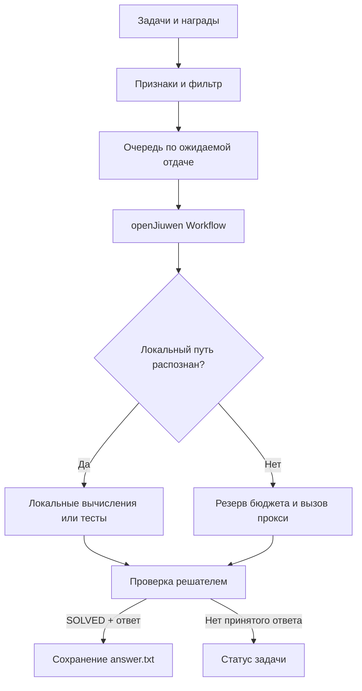

# Budget-Aware Agent Harness — openJiuwen Challenge'26


Бюджетно-ориентированный харнесс кодового агента на базе
[openJiuwen](https://github.com/openJiuwen-ai/agent-core) для автономного
решения задач в условиях ограниченного токенного бюджета.

Агент получает пул задач и самостоятельно определяет порядок их выполнения:
оценивает ожидаемую стоимость, учитывает награду и признаки выполнимости.
Для распознанных задач используются локальные решатели, а при необходимости
агент обращается к языковой модели через прокси. Расход всех запросов
учитывается в общем бюджете; каждый готовый ответ сохраняется сразу после
решения задачи.

Харнесс поддерживает четыре типа задач: **исправление кода, анализ данных,
математические вычисления и поиск по базе знаний**.


При разработке команда последовательно проверяла гипотезы о локальном
решении задач, распределении бюджета, выборе моделей и проверке ответов.
Подробные результаты, в том числе неудачные эксперименты, доступны в
[реестре гипотез](HYPOTHESES.md) и каталоге [экспериментов](experiments/).

### Запуск контейнера

При проверке организаторы передают адрес прокси, ключ и бюджет через
переменные окружения. Ключи не хранятся в репозитории.

Контейнер запускается на каталоге задач, предоставленном организаторами:

```bash
docker build -t hack:latest .

docker build -t hack:latest .; if ($LASTEXITCODE -eq 0) { docker run --rm --network bridge -e LLM_BASE_URL -e LLM_API_KEY -e BUDGET=3000 -v "${testDir}:/data/tasks:rw" --read-only --tmpfs /tmp:rw,size=2g -e HOME=/tmp --cap-drop ALL --security-opt no-new-privileges --cpus 4 --memory 16g --pids-limit 512 --workdir /app --entrypoint python hack:latest /app/run_agent.py --tasks-dir /data/tasks }
```

### Переменные запуска

| Параметр | Назначение |
|---|---|
| `LLM_BASE_URL` | Адрес API-прокси |
| `LLM_API_KEY` | Ключ доступа к прокси |
| `BUDGET` | Общий бюджет в приведённых выходных токенах |
| `--tasks-dir` | Каталог с задачами |
| `--budget` | Явный бюджет; имеет приоритет над `BUDGET` |
| `--max-concurrency` | Количество параллельных сессий: от 1 до 5 |
| `--out-file` | Необязательный путь к общему JSON-файлу с ответами |

Порядок выбора бюджета:

```text
--budget → BUDGET → TOKEN_BUDGET → 100000
```

`100000` — запасное значение, используемое, если бюджет не передан.

Логи и журнал учёта бюджета записываются в `/tmp/openjiuwen_logs/`.

## Входные данные и результаты

`--tasks-dir` указывает на каталог с подкаталогами задач. Каждый из них содержит `task.json` с типом, инструкцией и `reward`; рабочие файлы находятся рядом или в `workspace/`.

```text
/data/tasks/
└── task_id/
    ├── task.json
    ├── answer.txt        # создаётся при сохранении ответа
    └── workspace/        # необязательный каталог с файлами задачи
```

При штатной финализации результат `SOLVED` с ответом атомарно записывается в корневой `answer.txt` и дублируется в `workspace/answer.txt`, если `workspace/` существует. Для coding сохраняется исправленный файл и записывается `DONE`. Успешный выход программы или доступные тесты сами по себе не гарантируют прохождение скрытых тестов.

### Формат `task.json`

`task.json` содержит описание задачи и её награду.

| Поле | Назначение |
|---|---|
| `task_id` | Идентификатор задачи. Если поле отсутствует, используется имя её каталога |
| `task_type` | Тип задачи: `coding`, `data_analysis`, `math` или `search` |
| `instruction` | Текст условия и требования к ответу |
| `reward` | Количество баллов за верное решение; используется при ранжировании задач |


## Как работает решение



Фильтр ищет ограниченный набор признаков невозможности, например явно отсутствующие данные и деление на ноль в полностью разобранном плане; неопределённость и нехватка бюджета не доказывают невыполнимость. Очередь ранжирует кандидатов по награде, эвристике успеха и медианной стоимости типа. Внутри задачи сначала применяется подходящий локальный решатель; если его недостаточно, может вызываться LLM.

Для каждой задачи [`workflow_runner.py`](harness/workflow_runner.py) создаёт настоящий openJiuwen Workflow `Start → Solve → Finalize → End`. HTTP-запросы выполняет собственный мост внутри `Solve`; SDK управляет процессом. Подробности доменных решателей, моделей, проверки и ограничений — в [архитектуре](docs/ARCHITECTURE.md).

## Архитектура решения

Харнесс обрабатывает задачи в несколько этапов: извлекает признаки из
`task.json` и рабочих файлов, проверяет известные признаки невыполнимости
и формирует очередь с учётом награды, вероятности успеха и оценочной
стоимости задачи. Для каждой задачи создаётся отдельный
[openJiuwen Workflow](harness/workflow_runner.py): `Start → Solve →
Finalize → End`. Внутри `Solve` выбирается решатель по типу задачи:
`coding`, `data_analysis`, `math` или `search`. Сначала решатель
пытается применить поддерживаемый локальный способ; если его недостаточно,
он может обратиться к модели через прокси. Перед каждым запросом общий
`BudgetTracker` резервирует бюджет и после ответа учитывает фактический
расход. На этапе `Finalize` принятый ответ сохраняется в `answer.txt`.
Подробности управления токенами описаны в разделе
[«Управление бюджетом»](#управление-бюджетом).

## Управление бюджетом

Харнесс управляет **общим бюджетом для всего набора задач**: в него входят
вызовы, использованные для решения, повторных попыток и обработки ошибок.
Все значения внутри планировщика выражаются в **приведённых выходных токенах**.

### 1. Как считается стоимость запроса

По регламенту **10 входных токенов равны 1 выходному**. Токены рассуждений
также считаются как выходные:

```math
C_{\text{effective}} =
\frac{N_{\text{input}}}{10}
+
N_{\text{output, including reasoning}}
```

где:

- $N_{\text{input}}$ — количество входных токенов;
- $N_{\text{output, including reasoning}}$ — общее количество выходных
  токенов с учётом токенов рассуждений.

Все входные токены учитываются полностью, даже если провайдер использовал
кэш.

Рассуждения не должны учитываться дважды. Поэтому обработка полей
`completion_tokens` и `reasoning_tokens` зависит от подтверждённого
контракта `usage` прокси. В стандартной конфигурации этот контракт для
reasoning считается неподтверждённым: соответствующие вызовы блокируются
до отправки запроса.

### 2. Откуда берётся общий бюджет

Бюджет выбирается в следующем порядке:

```text
1. Аргумент --budget
2. Переменная окружения BUDGET
3. Переменная окружения TOKEN_BUDGET
4. Значение по умолчанию — 100000
```

Значение `100000` — **запасное**, применяемое при отсутствии других
значений. Фактический лимит на проверке может отличаться.

### 3. Как выделяется бюджет на задачу

Перед запуском задачи планировщик оценивает её ожидаемую стоимость на
основе типа и извлечённых признаков. При выделении бюджета учитываются:

- оценка стоимости задачи;
- её награда `reward`;
- минимальный бюджет для некоторых типов задач;
- оставшийся общий бюджет.

В стандартном профиле `csv-roomy` используются следующие минимальные
ориентиры для распределения:

| Тип задачи | Минимальный ориентир бюджета |
|---|---:|
| `search` | 300 токенов |
| `data_analysis` | 1000 токенов |
| `coding` | 800 токенов |
| `math` | Отдельный минимум не задан |

Выделенный лимит **не превышает доступный остаток общего бюджета**.
Эти значения не означают, что указанное количество токенов обязательно
будет потрачено: задача может решиться локально или потребовать меньше
вызовов.

Для многотабличных CSV-задач в профиле `csv-roomy` максимальная длина
вывода модели составляет до **600 токенов на соответствующий запрос**.
Фактический лимит может быть уменьшен при резервировании с учётом остатка
бюджета.

### 4. Как резервируется стоимость запроса

За общий учёт отвечает
[`BudgetTracker`](harness/planner/budget_tracker.py). Перед отправкой
каждого HTTP-запроса он под `asyncio.Lock`:

1. проверяет доступный остаток общего бюджета и лимита задачи;
2. оценивает стоимость входного контекста;
3. резервирует оценку входа и допустимый объём выходных токенов;
4. при необходимости уменьшает `max_tokens` либо отклоняет запрос.

Оценка резерва имеет вид:

```math
R =
\frac{\widehat{N}_{\text{input}}}{10}
+
N_{\text{output cap}}
```

Здесь N(input) — оценка размера входа,
а N(output cap) — фактический лимит выхода, установленный
для запроса после проверки бюджета.

Размер входа оценивается по длине промпта в UTF-8-байтах с дополнительным
запасом. Это **эвристика, а не гарантированная верхняя граница**: точное
количество токенов становится известно из ответа прокси.

### 5. Что происходит после запроса

После получения ответа фактический расход из поля `usage` учитывается
**до разбора содержимого ответа**. Поэтому расход записывается и в случае,
когда ответ модели оказался некорректным или был обрезан.

Возможны следующие ситуации:

- **Расход известен:** резерв закрывается, фактическое использование
  добавляется к общему и к бюджету задачи.
- **Запрос не был отправлен:** резерв освобождается.
- **Расход неизвестен:** например, соединение оборвалось или корректный
  `usage` отсутствует. Резерв сохраняется, новые платные вызовы
  блокируются.
- **Фактический расход превысил резерв:** расход учитывается, а новые
  платные запросы останавливаются. Уже произошедший перерасход отменить
  нельзя.

Если платные вызовы остановлены или бюджет равен нулю, харнесс может
продолжать обрабатывать задачи, для которых доступно локальное решение
без обращения к модели.

### 6. Параллельность и журнал

В стандартном профиле одновременно выполняется **одна задача**.
Аргумент `--max-concurrency` позволяет задать до **пяти параллельных
сессий**. Общий `BudgetTracker` синхронизирует резервирование запросов
между ними.

Логи работы и журнал учёта бюджета записываются в:

```text
/tmp/openjiuwen_logs/
```

Приведённые баллы измерены авторским проверяющим кодом. Бюджет и расход — в приведённых токенах; они относятся к указанному эксперименту, а не к будущему прогону.

| Проверка | Набор и бюджет | Результат | Отчёт |
|---|---|---|---|
| Финальная API-регрессия | 31 знакомая смешанная задача, 26 выполнимых; бюджет **3000** | **26/26**, 78/78 баллов; расход **1820,2**, 23 запроса | [E129](experiments/E129_submission_summary.json) · [детали](experiments/E129_submission_baseline_live_20261113T092505061530/report.json) |
| Сравнение очередей | 100 авторских задач, 83 выполнимых; бюджет **500** | 105 баллов против 71 у базового ROI; расход 373,1 и 373,3 | [E115](experiments/E115_interaction_summary.json) |
| Выбор math-промпта | 43 известные задачи при 3000; 18 новых авторских задач при **800** и **2000** | Исходный промпт: 99, 15 и 26 баллов; короткий: 94, 17 и 27 | [E131](experiments/E131_score_selection_summary.json) · [решение](experiments/E132_final_selection_release.json) |

В E129 зафиксированы **235** тестов на момент проверки; позднее отчёт о выборе релиза указал **241**. При отборе промпта сумма за три прогона составила 140 против 138; это не результат одного теста. Набор из 18 задач повторялся при двух бюджетах. Критерий скорректирован после аудита правильного сохранённого файла со статусом `FAILED`; результаты и поправка сохранены в E131.

Сравнения проводились на авторских наборах. Результаты отдельных исторических версий не следует считать измерениями итоговой версии на новом наборе. История, расширенные таблицы и ссылки на траектории — в [исследовательской документации](docs/EXPERIMENTS.md).


## Ограничения и документация

- Опциональная AST-перепроверка числовых констант, компактный контекст KB и общий evidence-формат для search исследовались, но не включены в стандартный путь выбранного runtime.
- `SUPPORTED` в эксперименте не означает, что механизм включён в релиз: эти статусы разделены в [реестре гипотез](HYPOTHESES.md).
- Сохранённые файлы и доступные тесты не заменяют независимую проверку организаторов; запуск генерируемого Python в рабочем каталоге — не отдельная защищённая ОС-песочница.
- [Архитектура](docs/ARCHITECTURE.md) · [Эксперименты и траектории](docs/EXPERIMENTS.md) · [Реестр гипотез](HYPOTHESES.md) · [Предыдущая передача](HANDOFF.md).

Лицензия: [MIT](LICENSE).

