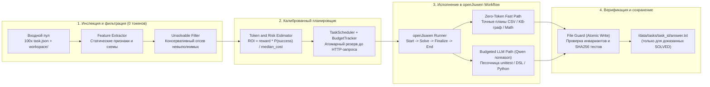
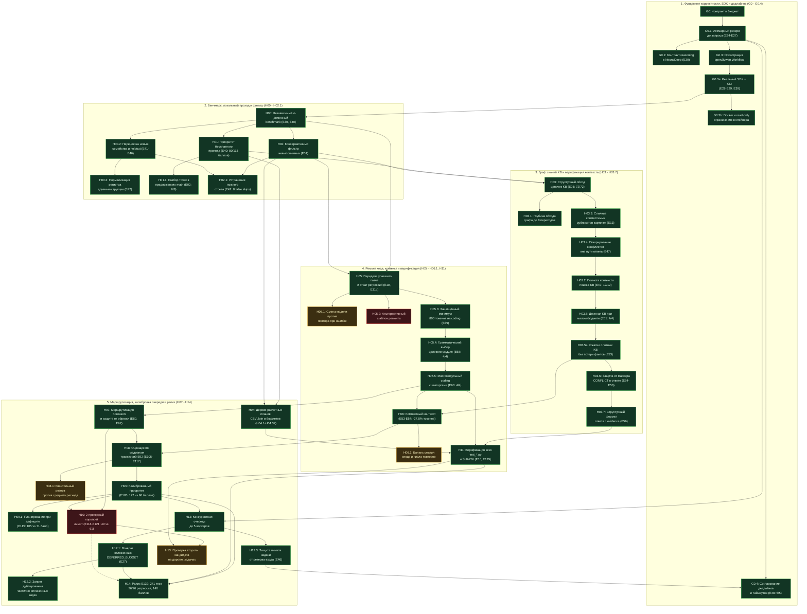
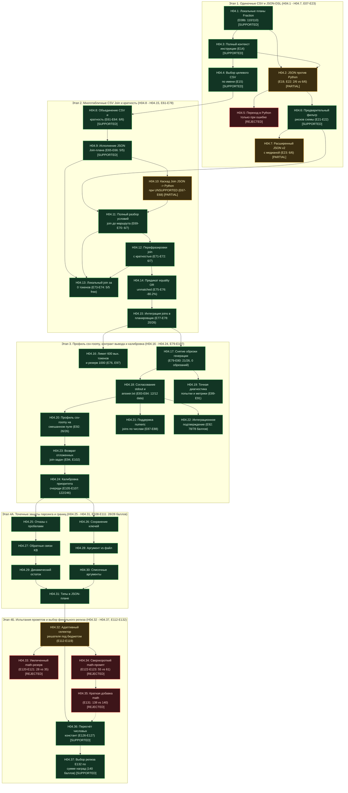
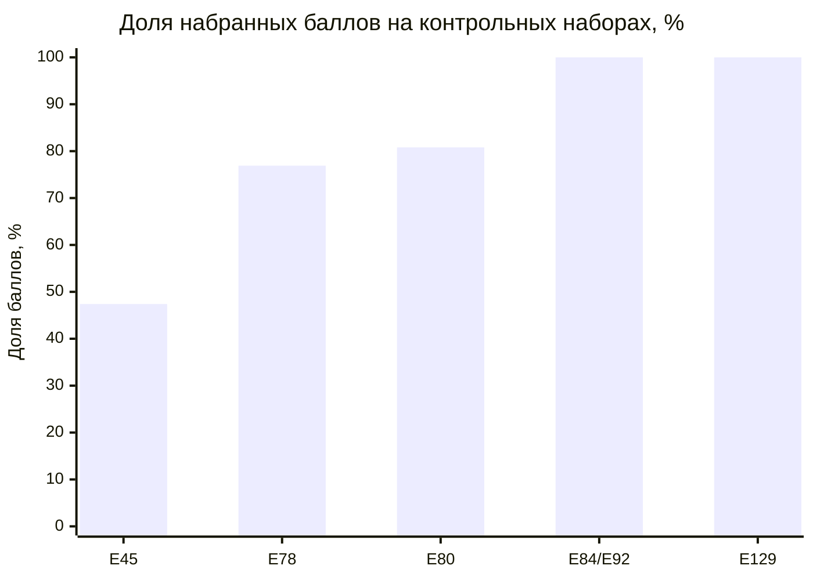
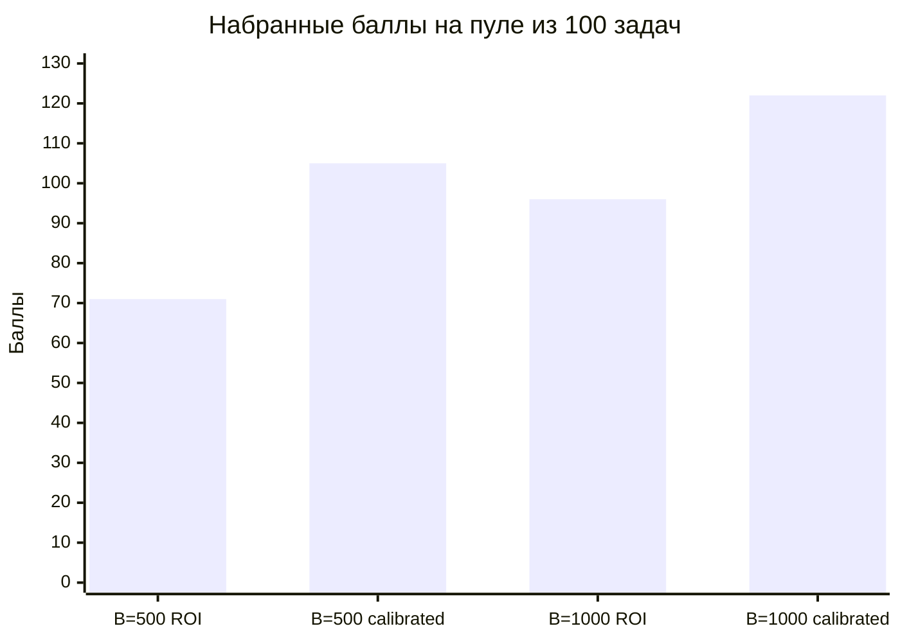
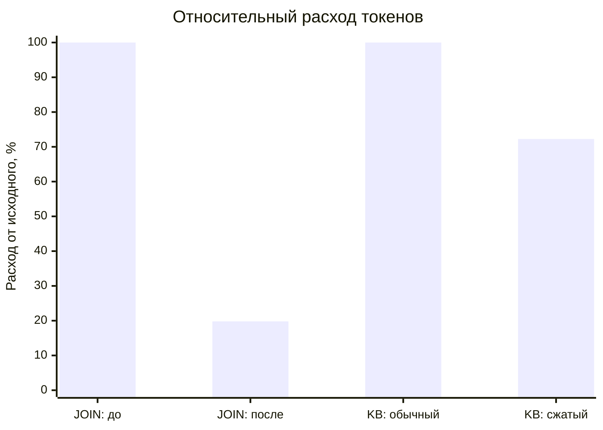
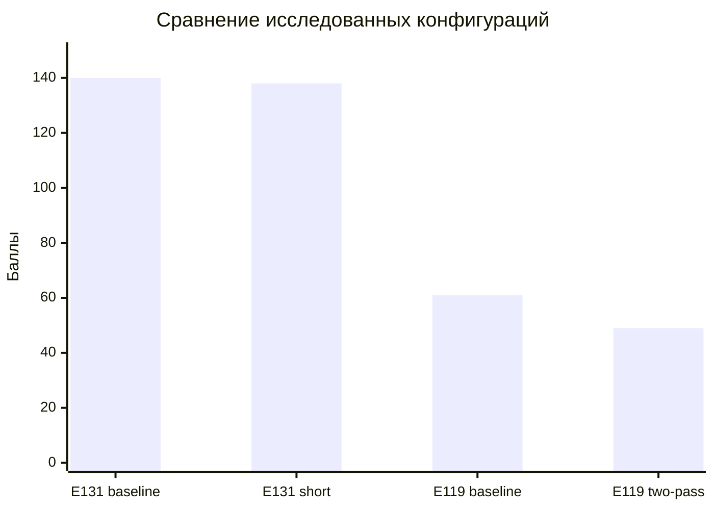

# Budget-Aware Agent Harness — openJiuwen Challenge'26


Бюджетно-ориентированный харнесс кодового агента на базе фреймворка `openjiuwen==0.1.19` ([GitHub `openJiuwen-ai/agent-core`](https://github.com/openJiuwen-ai/agent-core)) для автономного решения смешанного пула из 100 задач (`coding`, `data_analysis`, `math`, `search`) при жёстком лимите токенов (`BUDGET=100000`) и наличии 15–25% заведомо невыполнимых задач.

Итоговая конфигурация проекта (**релиз `E132`: `calibrated + csv-roomy` с базовым math-промптом**) прошла **132 экспериментальные итерации (`E00–E132`)**, проверку **78 формализованных гипотез и подгипотез (`G0–G0.4`, `H00–H14`, включая ветви `H03.1–H03.7`, `H04.1–H04.37`, `H05.1–H05.5`, `H12.1–H12.3`)** и **241 автоматический unit-тест**, обеспечивая **100% решение регрессионного API-пула (`26/26` задач, `78/78` баллов)** и максимальную сумму наград на независимых стресс-тестах (**`140` баллов** по серии контрольных прогонов `E131–E132`).

### Ключевые метрики финального релиза (`E129–E132`)

| Показатель | Значение в релизе `E132` | Подтверждающий артефакт |
| :--- | :--- | :--- |
| **Регрессия на полном смешанном пуле (API)** | **`26 / 26` задач (`78 / 78` баллов, 100%)** | `E92`, `E104`, `E117`, `E129` |
| **Бесплатное покрытие при `BUDGET=0`** | **`24 / 32` задачи (`80 / 113` баллов за `0` токенов)** | `E40` (`Zero-Token Fast Path`) |
| **Прирост калиброванного планировщика (`B=500`)** | **`+47.9%` по баллам (`105` против `71` у базового ROI)** | `E115–E116` (пул 100 задач) |
| **Прирост калиброванного планировщика (`B=1000`)** | **`+27.1%` по баллам (`122` против `96` у базового ROI)** | `E105–E107` (пул 100 задач) |
| **Ложные отсевы выполнимых задач (`false_skips`)** | **`0` (строго консервативный фильтр)** | `E01`, `E30`, `E42` |
| **Автоматическое тестовое покрытие** | **`241 / 241` unit- и интеграционных тестов** | `pytest tests/ -v` |

## 1. Архитектура решения

Харнесс построен вокруг графа исполнения `openJiuwen` (`Start -> Solve -> Finalize -> End` в [harness/workflow\_runner.py](https://www.google.com/search?q=https://github.com/aaalinuxxx/openjuuweg/blob/main/harness/workflow_runner.py)) и разделяет обработку каждой задачи на четыре защищённых контура:



### Ключевые инженерные механизмы

* **Реальная оркестрация `openJiuwen` (`harness/workflow_runner.py`):** Каждая задача проходит через изолированный экземпляр `Workflow` с уникальными `workflow_id` и `session_id` (`max_retries=0` на узлах графа, чтобы исключить скрытые повторные списания токенов внутри SDK). При запуске в `--read-only` контейнере все логи и временные песочницы направляются в `/tmp`.
* **Атомарное резервирование бюджета (`harness/planner/budget_tracker.py`):** Учёт ведётся в приведённых выходных токенах по формуле регламента (где `completion_tokens` в API NeuralDeep уже включает `reasoning_tokens`):
  ```text
  Cost_eff = (prompt_tokens / 10) + completion_tokens
  ```
  До отправки каждого HTTP-запроса под `asyncio.Lock` резервируется верхняя оценка стоимости (`input_estimate / 10 + max_tokens`). Фактический `usage` списывается сразу по получении ответа до парсинга `choices`. При неизвестном расходе (обрыв транспорта или отсутствие `usage`) новые платные вызовы мгновенно блокируются, а локальные решатели продолжают набирать баллы за `0` токенов.
* **Калиброванная очередь по медианам траекторий (`harness/planner/scheduler.py`, `token_estimator.py`):** Задачи ранжируются по ожидаемой отдаче на приведённый токен:
  ```text
  Priority(i) = (reward(i) * P_success(i)) / median_cost(task_type(i))
  ```
  Задачи с детерминированным локальным путём (`Zero-Token`) получают наивысший приоритет и выполняются даже при `BUDGET=0`.
* **Доменные решатели с верификацией (`harness/agents/`):**
  * **`search` (`search_solver.py`):** Строит полный индекс карточек `kb/*.md`, разрешает многошаговые цепочки (`Born`, `Founded`, `Employer`, `Mentor`, `Headquarters` глубиной до 8 переходов), объединяет совместимые дубликаты карточек с сохранением источников полей (`_sources`) и блокирует только те конфликты (`_conflicts`), которые лежат непосредственно на пути запроса. Для LLM-fallback используется сжатие контекста KB (`H03.5a`), обратные связи (`H04.27`) и строгая проверка цепочки доказательств (`evidence`, `H03.7`).
  * **`data_analysis` (`data_solver.py`, `calculation_plans.py`, `extended_plans.py`):** Выполняет точные расчёты на `Fraction` без ошибок двоичного `float`. Поддерживает одиночные и множественные CSV (`experimental_joins`: `INNER`/`LEFT` join, `OR`/unmatched предикаты `H04.14`, numeric joins `H04.21`, учёт кратности дубликатов `H04.8–H04.13`). При вызове LLM через профиль `csv-roomy` (`H04.16–H04.20`) согласует вывод между `stdout` и файлом `answer.txt` (`H04.18`) и проверяет неизменность исходных CSV по SHA256.
  * **`coding` (`coding_solver.py`):** Определяет целевой модуль по грамматике инструкции (`H05.4–H05.5`, `H04.28`, поддерживая многомодульные проекты с импортами зависимостей), выделяет защищённый бюджет (`H05.3`), запускает все `test_*.py` через `python -B` в изолированной копии `/tmp`, проверяет AST патча до запуска подпроцесса, передаёт в повторный промпт упавший код вместе с актуальным `traceback` (`H05`) и откатывает регрессии к лучшей версии (`best_code`).
  * **`math` (`math_solver.py`):** Локально исполняет полностью распознанные цепочки складских и арифметических операций с точным округлением на каждом шаге (`H01.1`); при новых формулировках генерирует и исполняет проверенный скрипт в песочнице с проверкой числовых констант (`H04.36`).
* **Консервативный фильтр невыполнимых задач (`harness/planner/unsolvable_filter.py`):** Разделяет состояния `PROVEN_UNSOLVABLE`, `UNKNOWN`, `DEFERRED_BUDGET` и `FAILED`. Для невыполнимых задач файл `answer.txt` не создаётся.

## 2. Полный граф гипотез и эволюции проекта (`G0–G0.4`, `H00–H14`, `E00–E132`)

Цветовая кодировка статусов в графах:
* **Зелёный (`SUPPORTED`)** — гипотеза подтверждена экспериментами и включена в релиз `E132`.
* **Жёлтый (`PARTIAL`)** — гипотеза подтверждена частично (область применения ограничена фильтром или роутером).
* **Красный (`REJECTED`)** — гипотеза опровергнута на контрольных прогонах и отброшена в пользу более надёжного решения.

### 2.1. Макро-граф базовых гипотез и доменных ветвей (`G0–G0.4`, `H00–H14`)



### 2.2. Детальный граф эволюции ветви `H04` (`H04.1–H04.37`, сбалансированная сетка в 2 колонки)

Вместо одной длинной горизонтальной шеренги узлы `H04.25–H04.37` сгруппированы в компактную двухколоночную структуру по этапам экспериментов (`E108–E111` и `E112–E132`), чтобы граф легко читался без прокрутки:



## 3. Полный реестр всех 78 гипотез и подгипотез проекта

| Семейство | Все входящие гипотезы и подгипотезы | Эксперименты | Статус | Ключевой результат и инженерный вывод |
| :--- | :--- | :--- | :--- | :--- |
| **`G0–G0.4`** *(7 гипотез)* | `G0`, `G0.1`, `G0.2`, `G0.3`, `G0.3a`, `G0.3b`, `G0.4` | `E24–E30`, `E39`, `E48` | **SUPPORTED** | Атомарный резерв бюджета до HTTP-запроса (`E24–E27`), учёт `reasoning_tokens` внутри `completion_tokens` (`G0.2`), реальный граф `openJiuwen` (`G0.3a`), согласование дедлайнов запроса и воркфлоу (`G0.4`, `5/5`). |
| **`H00–H02.1`** *(7 гипотез)* | `H00`, `H00.2`, `H00.3`, `H01`, `H01.1`, `H02`, `H02.1` | `E00–E02`, `E26`, `E30`, `E40–E46` | **SUPPORTED** | 4-доменный генератор и независимые holdout-пулы (`H00.2`); `0` ложных отсевов (`H02.1`); нормализация регистра инструкций (`H00.3`); `80/113` баллов при `BUDGET=0` (`H01`). |
| **`H03–H03.7`** *(9 гипотез)* | `H03`, `H03.1`, `H03.2`, `H03.3`, `H03.4`, `H03.5`, `H03.5a`, `H03.6`, `H03.7` | `E04–E06`, `E13`, `E47–E56` | **SUPPORTED** | Локальный обход цепочек KB (`72/72`), слияние совместимых карточек (`H03.3`), игнорирование побочных конфликтов вне пути (`H03.4`), компактная упаковка KB (`H03.5a`, `-27.8%` токенов), защита от маркера `CONFLICT` (`H03.6`) и проверка `evidence` (`H03.7`). |
| **`H04–H04.7`** *(8 гипотез)* | `H04`, `H04.1`, `H04.2`, `H04.3`, `H04.4`, `H04.5`, `H04.6`, `H04.7` | `E07–E08b`, `E14–E23` | **SUPPORTED / PARTIAL** | Точная арифметика `Fraction` (`110/110`), валидация области инструкции (`H04.3`) и выбор CSV по имени (`H04.4`). Чистый JSON-DSL терял редкие условия (`E22: 2/6`), поэтому дополнен предварительным роутером рисков (`H04.6`). |
| **`H04.8–H04.24`** *(17 гипотез)* | `H04.8`, `H04.9`, `H04.10`, `H04.11`, `H04.12`, `H04.13`, `H04.14`, `H04.15`, `H04.16`, `H04.17`, `H04.18`, `H04.19`, `H04.20`, `H04.21`, `H04.22`, `H04.23`, `H04.24` | `E61–E107` | **SUPPORTED** | Многотабличные `JOIN` с сохранением кратности (`H04.8–H04.13`), `OR`/unmatched предикаты (`H04.14`, `-80.2%` токенов), профиль `csv-roomy` (`H04.16–H04.17`), единый контракт `stdout`/`answer.txt` (`H04.18` $\to$ **`12/12` data-задач, `26/26` всего в `E84–E92`**) и калибровка приоритета (`H04.24`). |
| **`H04.25–H04.37`** *(13 гипотез)* | `H04.25`, `H04.26`, `H04.27`, `H04.28`, `H04.29`, `H04.30`, `H04.31`, `H04.32`, `H04.33`, `H04.34`, `H04.35`, `H04.36`, `H04.37` | `E108–E132` | **SUPPORTED (33–35 REJECTED)** | Защита граничных случаев парсинга и отказов (`H04.25–H04.31`, `28/28` баллов в `E109`); проверка констант (`H04.36`); отбраковка короткого math-промпта (`H04.34–H04.35`) и выбор финального релиза по сумме наград (`H04.37`, **`140` vs `138` баллов**). |
| **`H05–H06.1, H11`** *(9 гипотез)* | `H05`, `H05.1`, `H05.2`, `H05.3`, `H05.4`, `H05.5`, `H06`, `H06.1`, `H11` | `E09–E10`, `E31b`, `E39`, `E58–E60`, `E110–E111` | **SUPPORTED** | Передача упавшего патча во 2-ю попытку и откат регрессий (`H05`, `6/6` и `15/15` баллов в `E111`), минимум 800 токенов на `coding` (`H05.3`), грамматический выбор целевого файла в многомодульных задачах (`H05.4–H05.5`, `4/4`). |
| **`H07–H10, H12–H14`** *(11 гипотез)* | `H07`, `H08`, `H08.1`, `H09`, `H09.1`, `H10`, `H12`, `H12.1`, `H12.2`, `H12.3`, `H13`, `H14` | `E27`, `E92`, `E105–E121`, `E129–E132` | **SUPPORTED (H10 REJECTED)** | Маршрутизация `noreason` (`H07`), калиброванный ROI по медианам `E92` (`H08–H09`: рост с `71` до **`105` баллов** при `B=500` и с `96` до **`122` баллов** при `B=1000`), возврат `DEFERRED_BUDGET` (`H12.1`), финальная приёмка `H14` (`241` unit-тест, `26/26` регрессия). |

## 4. Ключевые экспериментальные результаты

### 4.1. Эволюция качества на сквозных прогонах с реальным API

| Этап и эксперимент | Набор задач | Бюджет | Решено задач | Набрано баллов | Расход токенов | Главный фактор роста |
| :--- | :--- | :---: | :---: | :---: | :---: | :--- |
| **`E39` (Публичный baseline)** | 8 эталонных задач (4 типа) | `3000` | **8 / 8** (100%) | **20 / 20** (100%) | `381.9` | 6 задач решены за `0` токенов, 2 `coding` — с первой попытки `noreason` (`H05.3`) |
| **`E40` (Zero-Token Dev)** | 40 синтетических задач | `0` | **24 / 32** (75%) | **80 / 113** (71%) | `0.0` | Чисто локальное исполнение + точный отсев 6 невыполнимых (`H01`, `H02`) |
| **`E45` (Сдвиг семейств)** | 19 новых задач (до `join`) | `3000` | 9 / 19 (47%) | 27 / 57 (47%) | `1234.3` | Выявлен потолок одиночных CSV и однофайлового `coding` (`H00.2`) |
| **`E78` (Включение CSV Join)** | 31 смешанная задача (26 решаемых) | `3000` | 20 / 26 (77%) | 60 / 78 (77%) | `1283.0` | Добавлены многотабличные соединения (`H04.8–H04.15`) и `H05.4–H05.5` |
| **`E80` (Расширение лимита задачи)** | 31 смешанная задача (26 решаемых) | `3000` | 21 / 26 (81%) | 63 / 78 (81%) | `1854.3` | Устранены все 6 обрезанных генераций (`H04.17`) |
| **`E84 / E92` (Контракт вывода CSV)** | 31 смешанная задача (26 решаемых) | `2700` | **26 / 26** (100%) | **78 / 78** (100%) | `1824.3` | Согласование `stdout`/`answer.txt` (`H04.18`) дало **12/12** в `data_analysis` |
| **`E129` (Пре-релизная регрессия)** | 31 смешанная задача (26 решаемых) | `2700` | **26 / 26** (100%) | **78 / 78** (100%) | `1789.1` | Полная проверка неизменности входов по SHA256 и **241 unit-теста** (`H14`) |

### 4.2. Стресс-тест планировщика при дефиците бюджета (100 задач)

| Эксперимент | Размер пула | Бюджет | Базовый ROI (баллы / решения) | Калиброванный планировщик (`H04.24`, `H08–H09`) | Прирост по баллам |
| :--- | :--- | :---: | :---: | :---: | :---: |
| **`E105–E107`** | 100 задач (83 решаемых, 246 баллов) | `1000` | `96 / 246` (26 задач) | **`122 / 246` (37 задач)** | **+27.1%** (+26 баллов при том же расходе `872.5`) |
| **`E115–E116`** | 100 задач (83 решаемых, 246 баллов) | `500` | `71 / 246` (21 задача) | **`105 / 246` (33 задачи)** | **+47.9%** (+34 балла за счёт точной оценки медианы) |

### 4.3. Финальный отбор релизной конфигурации (`E131–E132`, гипотеза `H04.37`)

| Набор задач | Бюджет | Релиз `Baseline` (`calibrated + csv-roomy`) | Кандидат `H04.35` (короткий math-промпт) |
| :--- | :---: | :---: | :---: |
| **Расширенный контрольный набор (43 задачи)** | `3000` | **99 / 105 баллов** | 94 / 105 баллов |
| **Независимый holdout-набор (18 новых задач)** | `800` | 15 / 48 баллов | **17 / 48 баллов** |
| **Независимый holdout-набор (18 новых задач)** | `2000` | 26 / 48 баллов | **27 / 48 баллов** |
| **Итоговая сумма баллов по серии** | — | **140 баллов (Выбрано в релиз)** | 138 баллов |
| **Суммарный расход токенов** | — | `4276.3` | `3824.7` |

## 5. Структура репозитория

```text
openjuuweg/
├── Dockerfile                      # Сборка контейнера (python:3.11-slim, совместим с --read-only)
├── requirements.txt                # Зафиксированные зависимости рантайма (openjiuwen==0.1.19, httpx и др.)
├── run_agent.py                    # Точка входа CLI (/app/run_agent.py --tasks-dir /data/tasks)
├── README.md                       # Описание архитектуры, полного графа гипотез и результатов
├── HYPOTHESES.md                   # Полный реестр 78 гипотез и журнал экспериментов E00–E132
├── HANDOFF.md                      # Релизная сводка E131–E132 и контрольные суммы сборки
├── harness/
│   ├── config.py                   # Конфигурация харнесса, моделей Qwen и контракты TaskContext/SolveResult
│   ├── workflow_runner.py          # Граф openJiuwen Workflow (Start -> Solve -> Finalize -> End)
│   ├── planner/                    # Извлечение признаков, фильтр невыполнимых, оценка ROI и BudgetTracker
│   ├── agents/                     # Доменные решатели (coding, data_analysis, math, search), планы и роутер
│   └── sandbox/                    # Изолированный запуск кода и атомарная запись answer.txt (file_guard)
├── scripts/                        # Скрипты воспроизводимых бенчмарков и генерации тестовых пулов
├── tests/                          # 241 unit- и интеграционный тест
└── experiments/                    # Артефакты и JSON-протоколы экспериментов E00–E132
```

## Эксперименты: как развивалось решение

Ниже показаны ключевые результаты разработки: качество на контрольных
наборах, работа планировщика под ограниченным бюджетом, экономия токенов
и сравнение финальных конфигураций.

### 1. Качество на контрольных наборах



| Этап | Ключевое изменение | Результат |
|---|---|---:|
| **E45** | Проверка на новых семействах задач | 27/57 баллов — **47.4%** |
| **E78** | Добавление многотабличных JOIN | 60/78 баллов — **76.9%** |
| **E80** | Увеличение лимита генерации для сложных задач | 63/78 баллов — **80.8%** |
| **E84/E92** | Согласование вывода через `stdout` и `answer.txt` | 78/78 баллов — **100%** |
| **E129** | Регрессионная проверка выбранного runtime | 78/78 баллов — **100%** |

> **Как читать график:** E45 и последующие этапы используют разные
> контрольные наборы. Поэтому столбцы показывают результаты отдельных
> проверок, а не строгое сравнение одного и того же набора на всех этапах.
> E129 — результат на авторском знакомом наборе, а не на скрытых задачах
> организаторов.

### 2. Планировщик при дефиците бюджета



| Серия | Бюджет | Базовый ROI | Калиброванная очередь | Разница |
|---|---:|---:|---:|---:|
| **E115–E116** | 500 | 71 балл | **105 баллов** | **+47.9%** |
| **E105–E107** | 1000 | 96 баллов | **122 балла** | **+27.1%** |

Калиброванная очередь ранжирует задачи по награде, эвристической оценке
вероятности успеха и медианной стоимости задач соответствующего типа.

> Сравнения проводились на авторских пулах из 100 задач с ограниченным
> бюджетом. E107 — исторический эксперимент: у калиброванной ветви
> обнаружены два неверных `SOLVED`, после чего ошибки исследовались и
> исправлялись. Результаты не гарантируют такой же прирост на скрытом наборе.

[Отчёт E107](experiments/E107_validation_summary.json) ·
[Отчёт E115](experiments/E115_interaction_summary.json)

### 3. Экономия токенов в отдельных экспериментах

На графике расходы нормированы: стоимость исходного варианта каждого
эксперимента принята за **100%**.



| Эксперимент | Исходный вариант | Новый вариант | Экономия |
|---|---:|---:|---:|
| **E76: обработка JOIN** | 2170.7 токена | **429.7 токена** | **80.2%** |
| **E53: сжатие контекста KB** | 276 токенов | **199.4 токена** | **27.8%** |

**E76:** сравнение проведено на семи целевых задачах. В новом варианте
решено 6 задач против 5 в исходном; одна задача осталась нерешённой
в обоих вариантах.

**E53:** расход сравнивается на пяти парных запросах. В каждой ветви
был один неверный ответ. Сжатие KB проверялось как экспериментальная
гипотеза и не стало стандартным способом построения контекста в релизе.

[Отчёт E76](experiments/E76_iteration_summary.json) ·
[Отчёт E53](experiments/E53_iteration_summary.json)

### 4. Выбор решений по результатам экспериментов



| Сравнение | Выбранный или базовый вариант | Проверенная альтернатива | Вывод |
|---|---:|---:|---|
| **E131–E132: math-промпт** | **140 баллов** | 138 баллов | Выбран исходный промпт |
| **E119: порядок решения, бюджет 2000** | **61 балл** | 49 баллов | Двухпроходная политика не включена |

> Это **два разных сравнения**, поэтому высоту столбцов E131 и E119
> нельзя сравнивать между собой напрямую. В E131 значение 140 — сумма
> баллов трёх прогонов на двух наборах; новый набор использовался при
> двух разных бюджетах. В E119 сравнение выполнено на отдельном
> авторском наборе из 24 задач.

Выбор итоговой конфигурации выполнен по сумме наград за правильные
сохранённые ответы. Отрицательные и незавершённые эксперименты также
сохранены в репозитории.

[Выбор релиза E131–E132](experiments/E131_score_selection_summary.json) ·
[Сравнение двух проходов E119](experiments/E119_two_pass_summary.json) ·
[Полный реестр гипотез](HYPOTHESES.md)


## 6. Сборка и запуск

### 6.1. Сборка Docker-образа

Сборка выполняется из корня репозитория:

```bash
docker build -t hack:latest .
```

Проверить размер готового образа:

```bash
docker images --format '{{.Repository}}:{{.Tag}} -> {{.Size}}'
```

Образ должен занимать менее **4 ГБ**.

Для сборки используются:

- базовый образ `python:3.11.10-slim-bookworm`;
- `openjiuwen==0.1.19`;
- зафиксированные версии прямых и транзитивных зависимостей из `requirements.lock`.

Во время сборки зависимости устанавливаются в образ. При запуске модели, веса и пакеты не скачиваются.

### 6.2. Запуск контейнера

### Запуск контейнера

При проверке организаторы передают адрес прокси, ключ и бюджет через
переменные окружения. Ключи не хранятся в репозитории.

Контейнер запускается на каталоге задач, предоставленном организаторами:

```bash
docker build -t hack:latest .

docker build -t hack:latest .; if ($LASTEXITCODE -eq 0) { docker run --rm --network bridge -e LLM_BASE_URL -e LLM_API_KEY -e BUDGET=3000 -v "${testDir}:/data/tasks:rw" --read-only --tmpfs /tmp:rw,size=2g -e HOME=/tmp --cap-drop ALL --security-opt no-new-privileges --cpus 4 --memory 16g --pids-limit 512 --workdir /app --entrypoint python hack:latest /app/run_agent.py --tasks-dir /data/tasks }
```

После каждой успешно решённой задачи харнесс сохраняет ответ в
`/data/tasks/<task_id>/answer.txt`.

Бюджет считывается из `BUDGET`. Если переменная недоступна внутри
контейнера, используется запасное значение `100000`.

### 6.3. Переменные и параметры запуска

| Параметр | Назначение |
|---|---|
| `LLM_BASE_URL` | Адрес прокси, обычно с окончанием `/v1` |
| `LLM_API_KEY` | Ключ доступа к прокси |
| `BUDGET` | Общий бюджет в приведённых выходных токенах |
| `--tasks-dir` | Каталог с задачами |
| `--budget` | Явно заданный бюджет; имеет приоритет над переменной `BUDGET` |
| `--max-concurrency` | Количество параллельных сессий: от 1 до 5 |
| `--out-file` | Необязательный путь к общему JSON-файлу с ответами |

Порядок выбора бюджета:

```text
--budget → BUDGET → TOKEN_BUDGET → 100000
```
Логи и журнал учёта бюджета записываются в `/tmp/openjiuwen_logs/`.
При запуске с `--rm` они удаляются вместе с контейнером, если каталог
отдельно не смонтирован.

### 6.4. Проверка без расхода токенов

После сборки образа можно запустить локальную проверку:

```bash
python scripts/container_smoke.py --image hack:latest
```

Проверка запускает контейнер с отключённой сетью, бюджетом `0` и
`--read-only`, после чего проверяет:

- локальное решение задач четырёх типов;
- сохранение `answer.txt` и общего JSON-файла;
- сохранность входных файлов;
- отсутствие HTTP-запросов;
- размер образа.

Для запуска unit-тестов в локальном Python-окружении:

```bash
python -m pip install -r requirements.lock
python -B -m unittest discover -s tests -q
```
